# CompostTech
## TRL 2 — Formulación conceptual de la propuesta tecnológica

### Información académica
* **Proyecto:** CompostTech (Monitor de Compostaje Doméstico Inteligente)
* **Curso:** Proyecto Integrador
* **Institución:** Universidad Peruana Cayetano Heredia
* **Periodo académico:** 2026-2
* **Integrantes (Equipo 07):**
  * Aliaga Cueva, Junior Moises
  * Aldana Porras, Leonela Angela
  * Ccoyllo, Alex 
  * Ancco, Juan
  * Turpo Cayo, Ruth turpo 

---

### Presentación
CompostTech es una propuesta tecnológica orientada al monitoreo continuo, regulación térmica y asistencia operativa del compostaje doméstico en entornos urbanos. El sistema contempla la integración de sensores de inserción en biomasa, acondicionamiento de señales en una placa de circuito impreso (PCB) personalizada basada en el microcontrolador ESP32, un mecanismo de extracción de aire forzado mediante un ventilador DC de 12 V, interfaces visuales locales (pantalla OLED con avatar dinámico de estados) y una aplicación móvil desarrollada en Flutter con gestión de usuarios mediante Firebase Authentication.

La presente propuesta se formula considerando los indicadores referenciales del nivel de madurez tecnológica TRL 2 (formulación del concepto de la tecnología e identificación de aplicaciones prácticas) establecidos en el Anexo 1 de la Directiva N.º 001-2022-CONCYTEC-P [1].

---

### 1. Artículos científicos relacionados con la propuesta tecnológica

#### 1.1. Dinámica fisicoquímica, fases térmicas y aireación en el compostaje
Román, Martínez y Pantoja [2] sistematizaron los parámetros críticos para la degradación aerobia de residuos orgánicos, estableciendo que la humedad debe mantenerse en un rango del 50 % al 70 % para evitar la inhibición biológica (por sequedad) o la generación de condiciones anaeróbicas (por saturación de poros). Asimismo, determinaron que durante la fase termófila la masa debe sostener temperaturas superiores a 55 °C por al menos tres días consecutivos para garantizar la sanitización frente a patógenos. Este estudio fundamenta los valores umbral del sistema de control de CompostTech, justificando la incorporación de la ventilación forzada y las recomendaciones manuales de volteo y adición de estructurante seco.

Complementariamente, Richard y Trautmann [3] modelaron el balance de materia y la tasa de humedad en reactores biológicos, demostrando que mezclas con alta concentración de restos de cocina (humedad del 80 % al 85 %) requieren una proporción aproximada de 3:1 en peso con material seco estructurante (humedad del 10 % al 15 %) para lograr un equilibrio inicial óptimo del 60 % al 65 %. Este antecedente proporciona el sustento del balance de carga de CompostTech para prototipos a escala de 10,08 L, donde se procesa una carga balanceada de 2,5 kg de mezcla húmeda por lote.

#### 1.2. Monitoreo embebido y proliferación de gases metabólicos
Vrettos, Kazamias y Lekkas [4] implementaron un sistema de adquisición para pilas de compostaje mediante controladores de código abierto y sensores de gases, demostrando que la liberación de compuestos volátiles y la alteración de la atmósfera interna anteceden a la aparición de olores nocivos y reflejan la transición hacia fases anaeróbicas. Este desarrollo respalda conceptualmente la inclusión de un sensor semiconductor (MQ-135) en CompostTech, no como un cromatógrafo selectivo de laboratorio, sino como un detector de proliferación general de gases metabólicos (CO₂, NH₃ y compuestos orgánicos volátiles) ubicado en una cámara periférica ventilada para accionar oportunamente el ventilador extractor.

Por su parte, Naser et al. [5] evaluaron redes de sensores integrados para el seguimiento abiótico en reactores de compostaje, reportando que los sensores sumergidos directamente en la biomasa deben poseer aislamiento galvánico o tecnología capacitiva sellada para evitar la corrosión electroquímica acelerada producida por los ácidos húmicos y el ambiente húmedo. Este análisis fundamenta la selección de sondas de temperatura blindadas en acero inoxidable (DS18B20) y sensores capacitivos anticorrosivos para el sustrato en CompostTech.

#### 1.3. Arquitectura IoT, microcontroladores y aplicaciones móviles
1.3. Arquitectura IoT, microcontroladores y algoritmos de aprendizaje automáticoRajamuneeswaran et al. [6] desarrollaron una estación de monitoreo basada en IoT orientada a la asistencia del usuario en tiempo real mediante alertas visuales y telemetría. Su trabajo demostró que la retroalimentación inmediata sobre variables físicas permite corregir oportunamente desviaciones en el proceso. En CompostTech, este principio se traslada a una doble interfaz: una visualización local en pantalla OLED empotrada con iconografía intuitiva (avatar dinámico) y una aplicación móvil desarrollada en Flutter, permitiendo al usuario registrar y supervisar el comportamiento de su reactor.Por su parte, Liu et al. [7] y Al-Fuqaha et al. [8] analizaron el procesamiento de datos sensoriales y sistemas de decisión en composteras inteligentes, concluyendo que la aplicación de histéresis en el control de actuadores evita conmutaciones erráticas y optimiza la estabilidad térmica del sistema. Este criterio se adopta en el firmware del ESP32 de CompostTech para regular el encendido del ventilador de 12 V sin sobrecargar la etapa de potencia comandada por el transistor 2N2222.   De manera complementaria, Lazrak et al. [21] evaluaron el empleo de modelos basados en inteligencia artificial y aprendizaje automático (machine learning) dentro de biorreactores interconectados, demostrando que la predicción de la dinámica de madurez y calidad del compost a partir de series temporales de temperatura, humedad y gases supera las limitaciones de las reglas estáticas de umbral fijo. Ello proporciona el sustento conceptual orientandolo hacia el entrenamiento de modelos de clasificación para inferir con precisión la fase biológica activa (mesófila, termófila, enfriamiento y maduración) y anticipar desbalances operativos antes de la emisión de olores molestos.

#### 1.4. Síntesis de la aplicación de los antecedentes
La Tabla 1 consolida la relación directa entre la evidencia científica revisada y su aplicación conceptual en el diseño de CompostTech.

**Tabla 1.** *Relación entre los antecedentes científicos y su aplicación en CompostTech.*

| Fuente | Evidencia científica documentada | Aplicación conceptual en CompostTech |
| :--- | :--- | :--- |
| **Román et al. [2]** | Parámetros biológicos: humedad óptima (50 % - 70 %) y sanitización térmica (> 55 °C por ≥ 3 días). | Definir la lógica de estados del avatar y los umbrales de disparo para las alertas y la ventilación forzada. |
| **Richard y Trautmann [3]** | Ecuaciones de balance de humedad y relación volumétrica de estructurante en residuos orgánicos. | Sustentar el balance de carga por lote (2,5 kg) y la proporción 3:1 de residuos vegetales respecto a hojas secas. |
| **Vrettos et al. [4]** | Detección de gases de degradación para evaluar la condición aerobia de la biomasa. | Sustentar el uso del sensor MQ-135 en una cámara periférica para medir la proliferación global de gases. |
| **Naser et al. [5]** | Análisis de corrosión y vida útil de sensores en medios químicamente agresivos y húmedos. | Justificar la selección de sondas DS18B20 en acero inoxidable y sensores de humedad de tipo capacitivo. |
| **Rajamuneeswaran et al. [6]** | Monitoreo IoT y notificación al usuario para la gestión doméstica de residuos. | Diseñar la interfaz móvil en Flutter y el avatar interactivo para guiar intervenciones manuales de volteo y riego. |
| **Liu et al. [7], Al-Fuqaha et al. [8]** | Algoritmos de decisión basados en umbrales e histéresis para reactores de compostaje inteligentes. | Diseñar la lógica de control del firmware en el ESP32 para activar la etapa de potencia del ventilador de 12 V. |

*Nota.* Elaboración propia a partir de los antecedentes científicos revisados en los apartados 1.1, 1.2 y 1.3.

---

### 2. Análisis preliminar de patentabilidad y protección

#### 2.1. Criterios de evaluación
La Decisión 486 de la Comisión de la Comunidad Andina [9], en su Régimen Común sobre Propiedad Industrial, establece que una invención es patentable cuando cumple con los requisitos de novedad (artículo 16), nivel inventivo (artículo 18) y aplicación industrial (artículo 19). Asimismo, el artículo 81 contempla la protección como modelo de utilidad para toda nueva forma, configuración o disposición de elementos de algún artefacto o mecanismo que permita un mejor funcionamiento, utilización o fabricación, o que le proporcione una ventaja técnica que antes no tenía.

En este marco, el análisis de CompostTech evalúa si la integración de la instrumentación electrónica en una PCB dedicada, la cámara externa ventilada para gases, los soportes desacoplados del sistema de mezcla y la bandeja inferior de lixiviados para maceración constituyen características diferenciadoras o ventajas técnicas protegibles.

#### 2.2. Publicaciones de patentes relacionadas con la propuesta
Se realizó una búsqueda exploratoria en las bases de datos de Google Patents, Espacenet y Patentscope empleando términos asociados a reactores domésticos (*smart compost bin*, *composting monitor device*, *leachate collection*, *mixing aerator*). La Tabla 2 resume los antecedentes tecnológicos más representativos identificados.

**Tabla 2.** *Comparación de publicaciones de patentes relacionadas con CompostTech.*

| Documento | Tecnología descrita | Comparación con CompostTech |
| :--- | :--- | :--- |
| **WO2021081597A1 [10]** | Dispositivo y sistema de monitoreo de compostaje mediante sensores de temperatura, humedad y gases en espacio de cabeza con enlace inalámbrico. | Comparte el monitoreo multicriterio, pero su sensor de gases se ubica sobre la tapa de manera fija. CompostTech incorpora una cámara periférica ventilada para gases y sondas extraíbles desacopladas del eje mezclador. |
| **US12189458B2 [11]** | Monitor de compostaje de bajo consumo con sensores modulares de penetración e interfaz inalámbrica de telemetría. | Se enfoca en una sonda vertical para pilas abiertas. CompostTech es un biorreactor integral de sobremesa (10,08 L) impreso en PLA que incorpora un eje mezclador manual, falso fondo y recolección de lixiviados. |
| **US20210371348A1 [12]** | Compostador doméstico automatizado con cámara de trituración, agitación electromecánica motorizada y condensación térmica. | Utiliza motores eléctricos de alta potencia y consumo de red. CompostTech emplea volteo manual mediante manivela helicoidal para reducir costos, limitando la automatización al flujo de aire forzado. |
| **CN212832860U [13]** | Biorreactor de compostaje a pequeña escala con bandeja deslizable inferior para recolección de líquidos residuales y ventilación pasiva. | Protege la disposición mecánica del cajón de recolección, pero carece de instrumentación electrónica, lazo de control On-Off con histéresis y conectividad IoT para el usuario. |

*Nota.* Elaboración propia a partir de las patentes analizadas en bases de datos internacionales [10]–[13].

#### 2.3. Evaluación preliminar de novedad, nivel inventivo y aplicación industrial
* **Novedad:** La configuración propuesta de CompostTech integra un biorreactor compacto de 10,08 L manufacturado en PLA, una manivela de mezclado helicoidal con zona central libre de paletas, soportes de riel deslizable para sondas de biomasa, una cámara periférica ventilada para el sensor MQ-135, una bandeja de recolección de lixiviados con sensor de nivel, una PCB personalizada de acondicionamiento basada en ESP32 con etapa de conmutación para ventilador de 12 V, y una arquitectura en la nube acoplada a una aplicación móvil en Flutter que incorpora un modelo de aprendizaje automático (machine learning) para la clasificación predictiva de las fases del compostaje y la generación dinámica de recomendaciones preventivas. Si bien existen antecedentes que abordan el monitoreo de variables abióticas o la aplicación de reglas estáticas de decisión en el estado del arte [10]–[13], la disposición funcional conjunta descrita y la sincronización entre el sensado multivariable, el control físico por hardware y la inferencia predictiva no se identificó de forma idéntica en las publicaciones de patentes examinadas. No obstante, al emplear principios de sensado conocidos, la novedad absoluta debe evaluarse con mayor profundidad en el estado de la técnica [9]–[13].
  
* **Nivel inventivo:** La simple integración de un microcontrolador con sensores comerciales de temperatura y humedad suele considerarse una solución previsible para un técnico en la materia. Sin embargo, CompostTech aporta características técnicas que superan dicha obviedad: por un lado, la disposición geométrica que previene el cizallamiento y destrucción de las sondas mediante una zona libre de paletas junto al aislamiento del sensor de gas en cámara periférica; y por otro, la sustitución de umbrales estáticos por un modelo de machine learning entrenado para predecir transiciones de fase biológica y anticipar desbalances antes de que ocurra la pudrición o la emisión de olores molestos [21]. Esta combinación de adaptabilidad mecánica y control predictivo proporciona un efecto técnico ventajoso frente a composteras tradicionales, aunque en esta etapa inicial se requiere consolidar los datos de entrenamiento para sustentar plenamente este requisito conforme al artículo 18 de la Decisión 486 [2], [7], [9], [21].
* **Aplicación industrial:** CompostTech presenta una clara aplicación en el sector de gestión y valorización doméstica de residuos sólidos orgánicos urbanos. Su arquitectura contempla componentes electrónicos, mecánicos y algoritmos digitales que pueden fabricarse, ensamblarse y desplegarse comercialmente para transformar residuos de cocina en abono seguro, cumpliendo cabalmente con el artículo 19 de la Decisión 486 [9].

#### 2.4. Posibles vías de protección
A partir del análisis realizado bajo la Decisión 486 de la Comunidad Andina [9], CompostTech contempla las siguientes vías de protección de propiedad intelectual:

* **Modelo de Utilidad (Vía prioritaria de hardware):** Conforme al artículo 81 de la Decisión 486 [9], la configuración tridimensional del biorreactor es protegible como modelo de utilidad ante la Dirección de Invenciones y Nuevas Tecnologías del INDECOPI. Esto ampara la ventaja técnica derivada de la disposición espacial: el chasis de sobremesa de 10,08 L con falso fondo ranurado, la cámara periférica exterior para gases, los rieles deslizables para sondas y la geometría del eje de manivela con espacio de guarda central que evita colisiones mecánicas.

* **Patente de Invención (Vía de método implementado por computadora):** Si bien los algoritmos matemáticos en sí no son patentables, la integración del modelo de machine learning como un método de control biotecnológico implementado por computadora —donde el modelo gobierna el encendido adaptativo del ventilador de 12 V y la emisión preventiva de alertas antes de la emisión de amoníaco— podría evaluarse como patente de invención si las pruebas empíricas demuestran una solución técnica no evidente frente a compostadores convencionales [9], [21].

* **Derecho de Autor (Software y Firmware):** El código fuente del firmware embebido en C++ para el ESP32, el código de la aplicación móvil multiplataforma desarrollada en Flutter y los scripts de entrenamiento del modelo de machine learning son susceptibles de registro inmediato como obras de software ante la Dirección de Derecho de Autor del INDECOPI [9].

---

### 3. Perfil o propuesta del proyecto

#### 3.1. Problema, propósito y alcance
En los hogares urbanos de Lima, más del 54 % de los residuos sólidos corresponden a materia orgánica putrescible [14]. La falta de herramientas accesibles para el control de la humedad y la aireación conduce comúnmente a la pudrición anaeróbica, malos olores y proliferación de vectores, desincentivando el compostaje doméstico.

* **Objetivo general:** Formular conceptualmente un monitor y biorreactor de compostaje doméstico inteligente a escala funcional (10,08 L) que integre sensores abióticos, acondicionamiento electrónico en PCB dedicada, ventilación forzada y una aplicación móvil para guiar las intervenciones de volteo, riego y drenaje del usuario.
* **Alcance:** El sistema está diseñado para procesar una carga útil de hasta 2,8 kg de biomasa vegetal por lote (cáscaras, frutas y verduras picadas mezcladas con estructurante seco en proporción 3:1). Quedan excluidos del procesamiento carnes, grasas, lácteos y materiales celulósicos pesados. La recolección de lixiviados tiene como fin evitar la saturación hídrica del sustrato y advertir el llenado de la bandeja para su posterior maceración externa, sin realizar tratamientos químicos automatizados in situ.

### 3.2. Arquitectura funcional propuesta

CompostTech se organiza en cuatro elementos principales: cámara de compostaje con módulo mecánico, módulo de instrumentación y control (PCB personalizada), subsistema de ventilación forzada y plataforma móvil con modelo analítico. La cámara de compostaje integra los elementos estructurales y de mezcla manual, mientras que los sensores alojados en su interior se enlazan mediante conexiones cableadas con la PCB de control ubicada en una caja exterior protegida. Desde el microcontrolador, la información se procesa para regular el actuador de extracción y se sincroniza hacia la aplicación móvil a través de una conexión inalámbrica a internet para su procesamiento predictivo.

#### Tabla 3. Componentes y funciones de la arquitectura conceptual de CompostTech

| Elemento | Composición conceptual | Función prevista |
| :--- | :--- | :--- |
| **Cámara de compostaje y módulo mecánico** | Chasis de PLA ($180 \times 280 \times 200\text{ mm}$), manivela helicoidal con zona libre de paletas[cite: 6], rieles guía[cite: 6], falso fondo ranurado y bandeja inferior extraíble. | Contener 10,08 L brutos ($\approx 7,0\text{ L}$ útiles) de biomasa, permitir el volteo manual asistido sin colisionar con las sondas y conducir efluentes hacia la bandeja inferior[cite: 6]. |
| **Placa de integración y control (PCB)** | Microcontrolador ESP32 DevKit V1[cite: 6], entradas para dos sensores capacitivos (D34, D35)[cite: 6], divisor resistivo para MQ-135 (D32)[cite: 6], pull-up para DS18B20 (D4)[cite: 6] y filtro RC para flotador P45 (D5)[cite: 6]. | Acondicionar y digitalizar las señales de biomasa, ejecutar el lazo de control térmico con histéresis, gestionar la pantalla OLED (I2C) y coordinar el envío de telemetría[cite: 6]. |
| **Subsistema de ventilación y potencia** | Ventilador DC de 12 V, transistor BJT 2N2222 (Q1)[cite: 6], diodo flyback 1N5819 (D4)[cite: 6], resistencia de base de 1 kΩ (R7)[cite: 6] y bornera de alimentación independiente de 12 V[cite: 6]. | Realizar la extracción de aire forzado activada desde el pin D23 del ESP32 para regulación térmica ante elevaciones críticas y evacuación de gases viciados[cite: 6]. |
| **Plataforma móvil y modelo analítico** | Aplicación móvil en Flutter, servicio `FirebaseAuth` con gestión de UID único, almacenamiento local mediante `SharedPreferences` y modelo de Machine Learning. | Gestionar el acceso multiusuario por UID, desplegar el dashboard de telemetría con avatar interactivo de tres estados y clasificar predictivamente la fase biológica del compost para orientar intervenciones. |

*Nota.* Elaboración propia a partir del esquemático electrónico en EasyEDA y las especificaciones de diseño de CompostTech[cite: 6].

La selección de los componentes electrónicos se sustenta en la documentación técnica de sus fabricantes. Espressif Systems [15] documenta las características de cómputo y conectividad inalámbrica del ESP32 DevKit V1[cite: 6], Analog Devices [16] detalla el protocolo OneWire y la resolución térmica de la sonda digital sumergible DS18B20[cite: 6], Zhengzhou Winsen Electronics Technology [17] describe la respuesta analógica y sensibilidad del sensor de calidad de aire MQ-135[cite: 6], y ON Semiconductor [18] especifica las capacidades de conmutación de corriente del transistor NPN 2N2222 para cargas inductivas[cite: 6]. Asimismo, Solomon Systech [19] documenta el controlador SSD1306 para la pantalla OLED mediante bus I2C[cite: 6], mientras que las propiedades mecánicas y térmicas del polímero PLA empleado en la estructura se sustentan en los ensayos de Ho et al. [20].

La arquitectura electrónica se integra mediante una placa de circuito impreso (PCB) de dos capas desarrollada en EasyEDA Pro[cite: 8], cuyo ruteado separa deliberadamente las pistas de señal de los componentes de potencia y organiza conectores externos tipo 2510 para facilitar el desacoplamiento de las sondas durante labores de limpieza[cite: 6, 7]. Por su parte, la arquitectura de software articula la autenticación en la nube mediante Firebase con persistencia local indexada por UID, sirviendo como soporte para la alimentación de datos hacia el modelo de aprendizaje automático propuesto para la clasificación predictiva de fases [21]. Ambas configuraciones convergen para consolidar un sistema semi-autónomo capaz de articular el sensado físico con la toma de decisiones asistida.

### 3.3. Secuencia prevista de operación e indicadores de control

CompostTech contempla una rutina de operación cíclica y semi-autónoma orientada al seguimiento continuo de la biomasa orgánica y la mitigación de condiciones anaeróbicas. La adquisición de datos se gestiona mediante el microcontrolador ESP32 DevKit V1, el cual ejecuta lecturas periódicas cada cuatro segundos a través de sus interfaces digitales y analógicas. Este intervalo temporal permite capturar de manera representativa la evolución de la temperatura en el núcleo mediante la sonda DS18B20 (OneWire), los niveles de humedad en los estratos superior e inferior a través de los sensores capacitivos (ADC), la concentración global de gases metabólicos en la cámara periférica mediante el sensor MQ-135 (ADC) y el estado binario del flotador magnético en la bandeja recolectora de lixiviados (GPIO).

Las señales analógicas y digitales adquiridas son sometidas a un preprocesamiento y filtrado digital en el microcontrolador para suprimir perturbaciones por ruido electromagnético o rebotes mecánicos, apoyado por la red RC física integrada en la PCB personalizada. Posteriormente, la información procesada se despliega de forma inmediata en la pantalla OLED de 0,96" mediante comunicación I2C, actualizando la iconografía dinámica del avatar local. En simultáneo, los registros se transmiten de forma inalámbrica mediante la conexión Wi-Fi hacia el entorno móvil desarrollado en Flutter, donde los datos se segmentan y almacenan localmente bajo el identificador único del usuario (UID) gestionado por `FirebaseAuth`, sirviendo a su vez como vector de entrada para el modelo de aprendizaje automático (*machine learning*).

El indicador principal de CompostTech corresponde al **Índice de Estado del Bioproceso (IEB)**, el cual clasifica la condición del compost en tres niveles operativos: óptimo (condiciones favorables), advertencia (desviaciones transitorias) e intervención crítica (riesgo inminente de putrefacción o emisión de olores). La determinación de este indicador y la activación de actuadores se fundamentan en reglas de decisión combinadas con un lazo de control On-Off con banda de histéresis:
- **Control térmico e integridad estructural:** Si la temperatura en el núcleo alcanza o supera los 58 °C, el microcontrolador activa automáticamente el ventilador de 12 V a través del transistor 2N2222 para forzar la extracción de calor. Esta ventilación se mantiene activa hasta que la temperatura desciende por debajo de los 55 °C, protegiendo tanto la microbiota benéfica del sobrecalentamiento como la estructura física del reactor, evitando alcanzar la temperatura de transición vítrea del polímero PLA (alrededor de los 60 °C).
- **Control de aireación y humedad:** Si los sensores capacitivos registran una humedad inferior al 45 %, el sistema genera una alerta visual de riego por déficit hídrico. Por el contrario, si la humedad sobrepasa el 70 % o el sensor MQ-135 detecta una proliferación elevada de gases volátiles (NH₃ y CO₂), el sistema activa el ventilador de extracción y emite una recomendación prioritaria para que el usuario accione la manivela helicoidal (entre 5 y 10 vueltas) e incorpore material vegetal seco estructurante en proporción 3:1.
- **Evacuación de lixiviados:** La activación del sensor flotador en la bandeja inferior notifica la saturación del compartimento (alcanzado el 75 % de su volumen útil), indicando la necesidad de escurrir los efluentes para su almacenamiento y posterior maceración externa, garantizando que el líquido no entre en contacto con la biomasa superior.

### Análisis funcional y generación de alternativas de diseño

Como parte del diseño conceptual de CompostTech, se realiza el análisis funcional del sistema mediante la caja negra, el esquema de funciones, la matriz morfológica y tres bocetos de alternativas de diseño. Estas herramientas permiten identificar las funciones necesarias para la degradación controlada de la materia orgánica, la regulación ambiental y la asistencia operativa, sustentando las soluciones consideradas antes del modelado tridimensional.

#### Caja negra del sistema CompostTech

La caja negra permite identificar las principales entradas y salidas del sistema CompostTech, clasificadas en flujos de energía, materia, información y señales, sin describir todavía el funcionamiento interno de sus componentes.

Entre las entradas se consideran la materia orgánica y el agua como medio de hidratación inicial del sustrato, el suministro de energía eléctrica o radiación solar auxiliar, y las señales de interacción del usuario correspondientes al encendido y apagado del dispositivo. Como salidas se obtienen el compost saludable, los lixiviados extraídos hacia la bandeja inferior, los gases de salida del bioproceso (CO y NH_3), el calor disipado derivado de la actividad metabólica de la microbiota y la información telemétrica junto con las alertas transmitidas tanto a la aplicación móvil como a la pantalla OLED local.

Asimismo, CompostTech contempla el monitoreo de variables abióticas para estimar el avance de la descomposición y anticipar condiciones anaeróbicas. La clasificación de los estados del compostaje se realizará mediante un algoritmo propio de aprendizaje automático (*machine learning*), cuyo entrenamiento y validación forman parte de las etapas posteriores del proyecto. Los resultados permitirán apoyar las decisiones de mantenimiento preventivo, tales como la incorporación de estructurante seco, riego o volteo manual asistido.

Asimismo, la caja negra contempla señales de interacción con el usuario, avisos de intervención e indicación del estado de funcionamiento del sistema. Estas funciones se consideran dentro de la propuesta conceptual y deberán definirse y validarse durante las siguientes etapas de desarrollo.

La Figura 1 presenta las entradas y salidas consideradas en el diseño conceptual de CompostTech.

  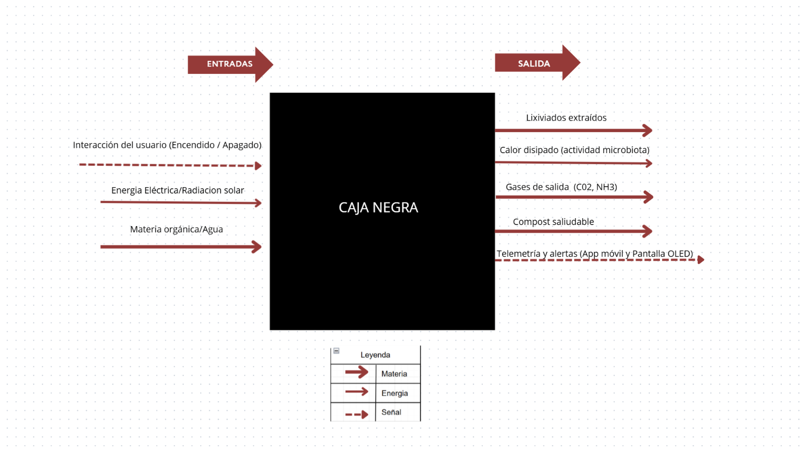

*Figura 1. Caja negra del sistema CompostTech.*

*Nota.* Elaboración propia. Se representan los flujos de energía, materia y señales del sistema CompostTech, considerando la valorización de materia orgánica, el control térmico de la biomasa y la asistencia operativa al usuario.

---

#### Esquema de funciones del sistema CompostTech

El esquema de funciones de CompostTech representa la organización de las funciones necesarias para el monitoreo continuo, regulación ambiental y asistencia operativa en la transformación de residuos orgánicos domiciliarios. A diferencia de la caja negra, este esquema permite identificar las funciones internas del sistema y las relaciones entre ellas mediante flujos de energía, materia, información y señales.

Como se muestra en la Figura 2, la propuesta se organiza en seis bloques funcionales: sensores, actuadores, control, energía, sistema mecánico y transmisión de datos.

El bloque de sensores comprende la adquisición de señales fisicoquímicas mediante la medición de temperatura en el núcleo de la masa, el registro de humedad estratificada del sustrato, la concentración de gases metabólicos en cámara periférica y la detección de nivel de líquidos en el depósito inferior. Asimismo, contempla la digitalización y acondicionamiento de las señales obtenidas y el envío de la información hacia la etapa de control. Estas funciones permiten disponer de registros cuantitativos sobre el estado biológico del compost y el nivel de acumulación en la bandeja de efluentes.

El bloque de actuadores considera la activación de ventiladores para proporcionar ventilación forzada orientada a la disipación térmica y la evacuación de gases viciados. Como salidas se representan el flujo de aire inducido, los subproductos gaseosos evacuados y el calor disipado hacia el exterior. Estas funciones corresponden a los mecanismos de extracción y alivio ambiental previstos para CompostTech.

El bloque de control contempla las funciones de recibir la información acondicionada de los sensores, evaluar los umbrales de control con histéresis, gestionar la interfaz con el usuario, detectar fallas en sensores o actuadores activando el modo de funcionamiento seguro, generar la señal de accionamiento para la etapa de potencia de los ventiladores y emitir la señal visual de estado en la pantalla OLED local mediante la iconografía del avatar dinámico. Asimismo, incorpora la función de coordinar la transmisión de datos hacia la red inalámbrica Wi-Fi.

El módulo de energía contempla las funciones de captar y transformar energía eléctrica externa o solar, regular la carga, almacenar energía y acondicionar las líneas de alimentación necesarias para el control, los sensores y los actuadores de ventilación. Estas funciones tienen como finalidad proporcionar el suministro eléctrico continuo indispensable para la operación ininterrumpida de los componentes del sistema.

El módulo mecánico comprende las funciones de proporcionar la carcasa exterior de protección, sostener rígidamente los componentes, contener la masa de biomasa orgánica en degradación y albergar el contenedor inferior para los efluentes decantados. También incorpora la función de voltear el compost mediante una manivela helicoidal con zona central libre de paletas, con el propósito de descompactar y airear el sustrato sin impactar las sondas insertadas en el núcleo. En este bloque, los residuos orgánicos y el agua se representan como entradas de materia, mientras que el compost y los lixiviados constituyen las salidas del reactor.

Finalmente, el bloque de transmisión de datos comprende las funciones de recibir la información de procesamiento desde el microcontrolador, decodificar los paquetes de datos, ejecutar el análisis mediante inteligencia artificial (algoritmo Random Forest) para clasificar las fases biológicas, enviar los datos estructurados a la aplicación móvil y notificar al usuario de forma remota. Como salidas se contemplan los registros telemétricos, los avisos de intervención manual y las alertas preventivas. Estas funciones se consideran conceptuales y deberán implementarse y validarse durante las siguientes etapas de desarrollo.

La Figura 2 presenta el esquema de funciones de CompostTech, mostrando las relaciones entre los seis bloques funcionales y los flujos necesarios para su operación. Esta representación permite establecer una base para la elaboración de la matriz morfológica y la generación de alternativas de diseño.

  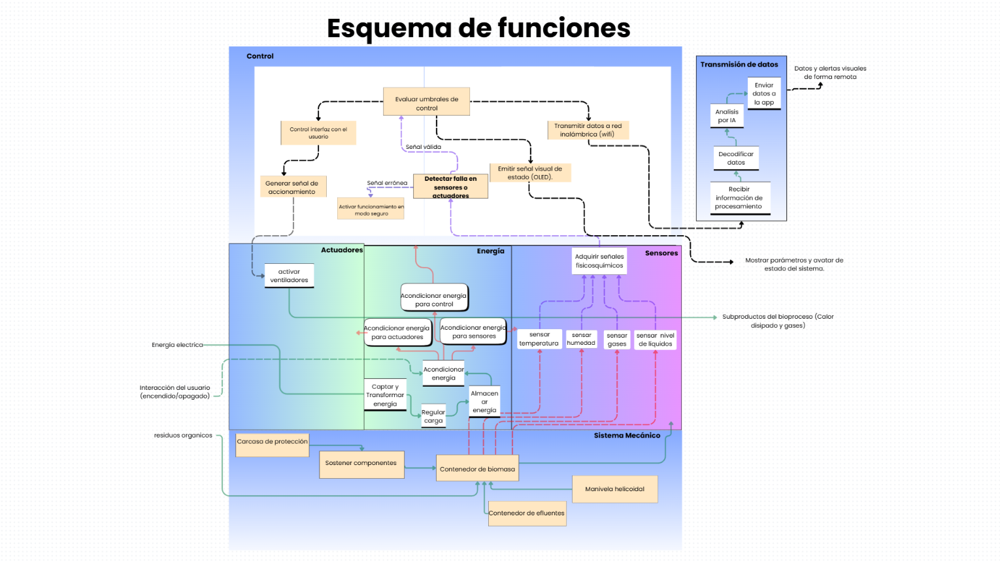

*Figura 2. Esquema de funciones del sistema CompostTech.*

*Nota.* Elaboración propia. Se representan los bloques de sensores, actuadores, control, energía, sistema mecánico y transmisión de datos, así como sus relaciones mediante flujos de energía, materia, información y señales. El esquema incluye la adquisición sensorial multivariable, el control térmico por ventilación forzada, la mezcla helicoidal manual, la interfaz visual local en OLED y el procesamiento analítico en la nube.

---

#### Matriz morfológica del sistema CompostTech

La matriz morfológica de CompostTech se elaboró a partir del análisis funcional del sistema, con la finalidad de identificar y comparar alternativas tecnológicas para el monitoreo, control ambiental y asistencia operativa del compostaje doméstico. Esta herramienta permite organizar las posibles soluciones para cada función técnica y establecer combinaciones que orientan el diseño conceptual del dispositivo.

La matriz presenta 11 funciones técnicas distribuidas en seis ámbitos funcionales: energía, sensórica abiótica, procesamiento y control, analítica de datos, acondicionamiento electromecánico y almacenamiento. Para cada función se plantearon tres alternativas, denominadas Concepto de Solución 1 (CS.1), Concepto de Solución 2 (CS.2) y Concepto de Solución 3 (CS.3), identificadas y enlazadas mediante trayectorias representadas por líneas de color rosa, rojo y azul, respectivamente.

En el módulo de suministro energético, se presentan alternativas para energizar el sistema. La Solución 1 contempla un kit solar de 10 W con controlador de carga Li-ion y pack 3×18650 con BMS, la Solución 2 un Power Bank de 20 000 mAh (20 W–22,5 W) con salida USB-C de 5 V, y la Solución 3 una fuente de alimentación conmutada de red.

En la instrumentación sensorial, se comparan alternativas para registrar temperatura, humedad, gases y nivel de lixiviados. Para la temperatura, la Solución 1 considera la sonda impermeable DS18B20 con bus OneWire, la Solución 2 un sensor PT100 con amplificador MAX31865, y la Solución 3 una termocupla tipo K con integrado MAX6675. En cuanto a la humedad, la Solución 1 contempla dos sensores capacitivos analógicos v1.2, la Solución 2 sensores industriales RS485 IP68 (SEN0600), y la Solución 3 un sensor multiparamétrico RS485 (SEN0601). Para el monitoreo de gases, la Solución 1 evalúa el sensor semiconductor MQ-135, la Solución 2 combina un sensor fotoacústico NDIR SCD41 junto con el MQ-135, y la Solución 3 un arreglo triple con SCD41, sensor electroquímico ME2-$\text{O}_2$ y MQ-135. En la detección del nivel de lixiviados, se comparan un sensor capacitivo exterior sin contacto XKC-Y25-T12V (Solución 1), un sensor de flotador vertical magnético tipo P45 (Solución 2) y un sensor fotoeléctrico sumergible DFRobot (Solución 3).

En el módulo de control y procesamiento, se presentan alternativas para gobernar el hardware y coordinar las comunicaciones. La Solución 1 contempla la placa NodeMCU ESP8266, la Solución 2 el microcontrolador ESP32 DevKit V1, y la Solución 3 una placa Arduino Uno R4 WiFi. Asimismo, para el análisis del estado del compost se evalúan reglas deterministas por umbrales fijos (Solución 1), un modelo predictivo basado en Random Forest (Solución 2) y un ensamble de árboles por gradiente XGBoost (Solución 3).

En el módulo electromecánico, se comparan opciones para airear y voltear la masa orgánica. La aireación contempla perforaciones pasivas laterales (Solución 1), extracción forzada mediante dos ventiladores USB 8025 de 5 V o ventilador axial de 12 V (Solución 2) y un ventilador radial centrífugo (*blower*) de 12 V (Solución 3). Para el volteo del compost, la Solución 1 evalúa un servomotor de alto torque MG996R de 13 kg·cm, la Solución 2 un mecanismo manual asistido por manivela helicoidal, y la Solución 3 un motorreductor DC acoplado a caja reductora.

Finalmente, en los módulos de visualización, notificación y almacenamiento se contrastan alternativas locales y remotas. La visualización abarca desde pantallas OLED monocromáticas de 1,3" locales hasta aplicaciones móviles en Flutter con notificaciones Push y dashboards web en React con sistemas de alertas. Para el almacenamiento de registros se comparan Google Firebase, bases de datos relacionales PostgreSQL / Supabase y servidores en MySQL.

Las tres soluciones se representan mediante rutas gráficas que identifican las opciones correspondientes a cada función técnica.

De las alternativas planteadas, el equipo adoptó la configuración trazada por la línea rosa (Solución preliminar 1) como base del diseño conceptual de CompostTech, considerando la compatibilidad de sus componentes con la placa PCB personalizada de dos capas, el bajo consumo energético, la protección mecánica de las sondas y la viabilidad económica del proyecto. Esta selección orienta los modelos tridimensionales, los diseños electrónicos y la arquitectura de software presentados en los siguientes apartados.

La Figura 3 presenta la matriz morfológica de CompostTech, mostrando las funciones consideradas, las alternativas tecnológicas propuestas y las tres rutas de solución.

  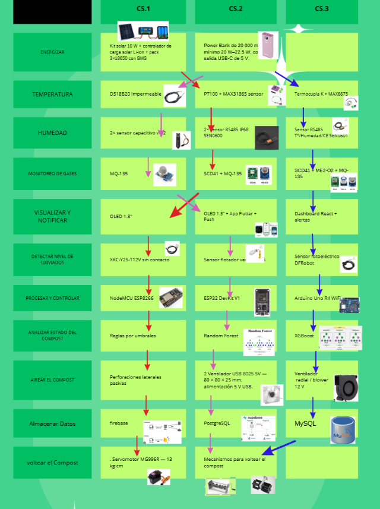

*Figura 3. Matriz morfológica del sistema CompostTech.*

*Nota.* Elaboración propia. La matriz presenta 11 funciones técnicas organizadas en ámbitos de sensórica, control, potencia, mecánica, analítica y comunicación. La trayectoria en color rosa corresponde a la configuración adoptada por el equipo como referencia para el desarrollo del proyecto. Las soluciones 2 y 3 representan configuraciones alternativas orientadas a la comparación técnica.

---

#### Boceto 1 — Solución preliminar 1 (Alternativa Seleccionada)

El primer boceto representa la configuración conceptual de CompostTech adoptada como base de diseño por el equipo. Plantea un biorreactor de sobremesa de disposición horizontal compacta, optimizado para espacios domésticos reducidos y terrazas urbanas.

* **Descripción técnica y funcional:**
  * **Estructura y cerramiento:** Chasis prismático rectangular fabricado mediante manufactura aditiva en PLA (10,08 L brutos), con tapa superior basculante de acceso rápido provista de manija ergonómica y cierres de presión para evitar la dispersión de olores.
  * **Suministro energético y potencia:** Techo inclinado superior que alberga un panel solar fotovoltaico de 10 W, conectado mediante cableado exterior protegido hacia una caja estanca lateral que aloja el banco de energía (Power Bank / batería Li-ion con BMS) y la placa de control.
  * **Aireación y disipación térmica:** Frontal con montaje empotrado para un ventilador axial DC gobernado automáticamente por el microcontrolador mediante histéresis térmica, asistido por una matriz de perforaciones pasivas en las paredes laterales para inducir flujo cruzado.
  * **Mezclado manual y decantación:** Eje central accionado por una manivela manual compacta exterior, con paletas curvas que conservan una zona de paso libre en el centro para salvaguardar las sondas de biomasa. La base inferior integra una bandeja colectora deslizable e independiente para retener los lixiviados decantados por gravedad.

  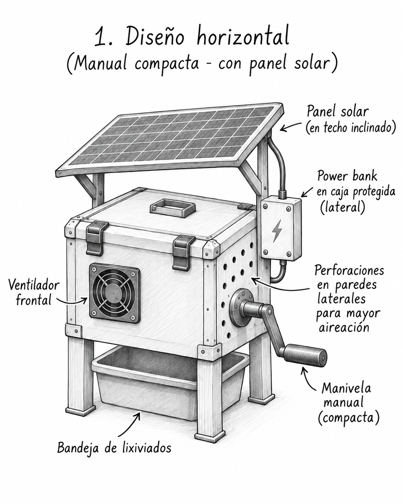
  
<em>Figura 4. Boceto de la Solución preliminar 1 del sistema CompostTech (Diseño horizontal compacto con panel solar).</em>

> **Nota.** Elaboración propia. Se ilustra la configuración de sobremesa seleccionada: reactor horizontal con panel solar superior inclinado, gabinete lateral de energía, ventilador axial frontal, manivela manual de volteo y bandeja deslizable de lixiviados.

---

#### Boceto 2 — Solución preliminar 2 (Alternativa de Doble Cámara Rotatoria)

El segundo boceto representa una alternativa de compostaje continuo basada en una compostera horizontal de tambor rotatorio dividida en dos compartimentos cilíndricos octagonales independientes.

* **Descripción técnica y funcional:**
  * **Operación por etapas paralelas:** Dispone de dos cámaras contiguas con tapas abisagradas independientes y ventanas transparentes de policarbonato para inspección visual directa del sustrato. Permite mantener una cámara en etapa activa de carga mientras la segunda se encuentra en fase de maduración biológica.
  * **Mecanismo de volteo rotatorio:** El tambor completo gira sobre un soporte estructural en caballete rígido (perfiles en A), accionado manualmente por una manivela lateral conectada a una brida central de transmisión.
  * **Ventilación pasiva distribuida:** Ambas tapas laterales integran un arreglo concéntrico de múltiples perforaciones circulares para la oxigenación pasiva continua durante el giro.
  * **Limitaciones técnicas de integración:** Aunque favorece el mezclado mecánico por volteo total, dificulta el enrutamiento fijo del cableado para sensores sumergidos (temperatura y humedad) y la recolección hermética de efluentes, requiriendo colectores móviles más complejos.

  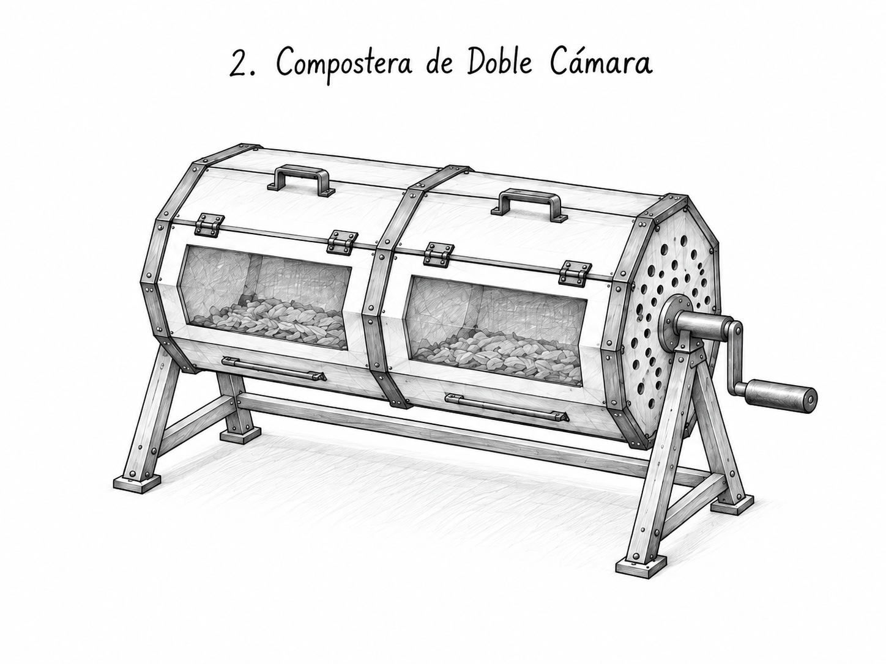
  
<em>Figura 5. Boceto de la Solución preliminar 2 del sistema CompostTech (Compostera de doble cámara rotatoria).</em>

> **Nota.** Elaboración propia. Alternativa basada en tambor rotatorio de doble compartimento con ventanas de supervisión y volteo manual perimétrico sobre caballete estructural.

---

#### Boceto 3 — Solución preliminar 3 (Alternativa de Torre Vertical con Tolva Cónica)

El tercer boceto propone una configuración en torre vertical octagonal inspirada en silos domésticos de alimentación por gravedad continua.

* **Descripción técnica y funcional:**
  * **Disposición volumétrica y flujo gravitatorio:** Cámara vertical octagonal sustentada sobre una base elevada de cuatro patas con travesaños de refuerzo. Los residuos frescos se introducen por la tapa superior con manija, mientras que el compost maduro se descarga mediante una compuerta inferior abisagrada con picaporte de seguridad.
  * **Ventilación pasiva multizona:** Toda la periferia del manto cilíndrico presenta perforaciones en patrón alternado para favorecer la convección térmica ascendente natural del aire caliente generado por la microbiota.
  * **Drenaje inferior por válvula:** La base inferior presenta una transición cónica que concentra los efluentes líquidos hacia una tubería de purga con válvula de bola inferior, facilitando la extracción directa de lixiviados hacia recipientes de almacenamiento externo.
  * **Evaluación de viabilidad:** Presenta facilidad para el drenaje líquido; sin embargo, carece de un sistema eficiente de volteo interno manual, dependiendo exclusivamente de aireación convectiva que incrementa el riesgo de compactación en estratos medios y bajos.

  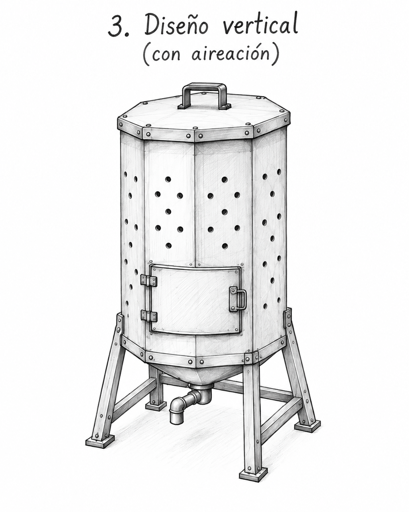
  
<em>Figura 6. Boceto de la Solución preliminar 3 del sistema CompostTech (Diseño vertical con aireación).</em>

> **Nota.** Elaboración propia. Alternativa en torre vertical con ventilación perimetral, descarga inferior por compuerta y purga cónica de lixiviados mediante válvula.

### 3.4. Representación del modelado tridimensional

Como parte de la formulación conceptual y validación geométrica de CompostTech, se desarrolló el modelo tridimensional del biorreactor mediante software CAD (Onshape) a escala funcional ($180 \times 280 \times 200\text{ mm}$, volumen total de $10,08\text{ L}$). Este diseño permite visualizar la distribución espacial de los componentes mecánicos, el recorrido del sistema de mezclado, los alojamientos de sensores y las cajas de protección electrónica, verificando la ausencia de interferencias antes de la manufactura aditiva en PLA.

El diseño estructural se compone de tres zonas principales:
1. **Cámara de mezclado y eje helicoidal:** En el interior de la cámara se ubica el eje central accionado por la manivela manual exterior, el cual incorpora paletas curvas distribuidas angularmente para descompactar y voltear la biomasa. La disposición de las paletas delimita una zona central de paso libre que evita impactos mecánicos contra las sondas de monitoreo insertadas en el sustrato.
2. **Caja electrónica y acoples externos:** En los laterales del chasis se aprecian los soportes atornillables para la caja electrónica estanca (destinada a alojar la PCB con el ESP32 y la etapa de conmutación), las rejillas para el flujo de ventilación forzada y la cámara periférica exterior diseñada para aislar el sensor semiconductor de gases de la condensación directa.
3. **Falso fondo y recolección de efluentes:** La parte inferior integra la transición hacia la base de drenaje pasivo que conduce los lixiviados hacia la bandeja colectora deslizable, asegurando que el líquido no sature la masa orgánica en degradación.

  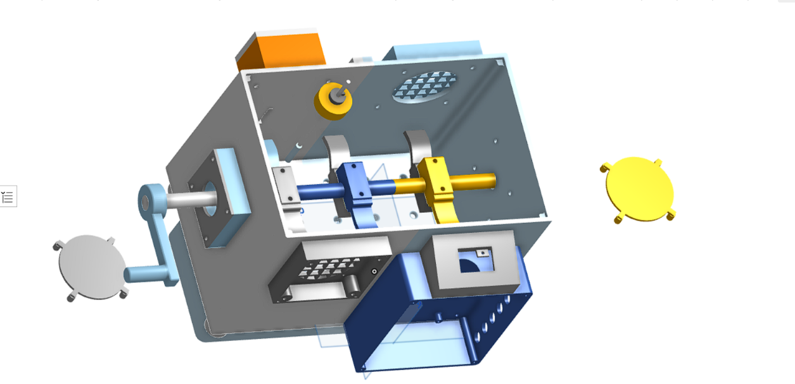

*Figura 1. Modelo tridimensional del biorreactor CompostTech desarrollado en CAD.*

*Nota.* Elaboración propia en Onshape. Se muestra la configuración volumétrica del biorreactor de 10,08 L a escala funcional, la disposición del eje con paletas de mezclado manual accionado por manivela exterior, los conductos de ventilación y el montaje exterior de los gabinetes electrónicos y de sensado.

### 3.4.4. Planos dimensionales de los componentes estructurales de CompostTech

Como complemento del modelado tridimensional, se presentan los planos dimensionales de los componentes estructurales, mecánicos y de instrumentación de CompostTech. Estos documentos técnicos permiten identificar la geometría de las piezas, sus dimensiones principales, espesores de pared, tolerancias de ensamble y elementos de fijación, orientando su fabricación mediante manufactura aditiva y su posterior integración física.

Los planos incluyen vistas ortogonales (alzado, planta y perfil), representaciones isométricas, cotas expresadas en milímetros y especificaciones técnicas de material y cantidad requerida. Esta documentación técnica formaliza las características constructivas de las piezas desarrolladas en software CAD (Onshape) y exportadas para manufactura aditiva en PLA.

---

#### 3.4.4.1. Planos dimensionales de la cámara de compostaje y sistema mecánico

Los siguientes planos describen los componentes estructurales de la cámara de descomposición aerobia, los mecanismos de volteo manual, guiado axial y arriostramiento. Se presentan de manera individual las piezas `parte1_caja_compostera`, `parte2_caja_compostera`, `tapa_compos`, `recipiente_lixiviados`, `manivela`, `abrasadera_superior`, `abracadera_inferior`, `collarin`, `retenedor`, `soporte_rodaje`, `tapa_rodaje`, `varilla1`, `varilla2` y `varilla3`.

##### 3.4.4.1.1. Plano dimensional de la pieza Parte 1 de la caja compostera
La pieza `parte1_caja_compostera` constituye la semicaja frontal del biorreactor. Su geometría prismática abierta conforma la mitad anterior de la cámara de degradación de 10,08 L brutos. Dispone de pestañas perimetrales con perforaciones para pernos pasantes M3 de unión con la sección posterior, nervaduras verticales de rigidización mecánica, ranuras inferiores horizontales que actúan como corredera para el falso fondo ranurado y un alojamiento semicilíndrico superior destinado al descanso del eje mezclador.

El plano muestra vistas ortogonales e isométrica con dimensiones generales de 280 mm de longitud, 140 mm de fondo y 200 mm de altura exterior. Se especifican barrenos de 3,4 mm de diámetro en las pestañas de unión, espesor uniforme de pared de 4 mm y radios de refuerzo en los vértices inferiores para evitar concentraciones de esfuerzo.

  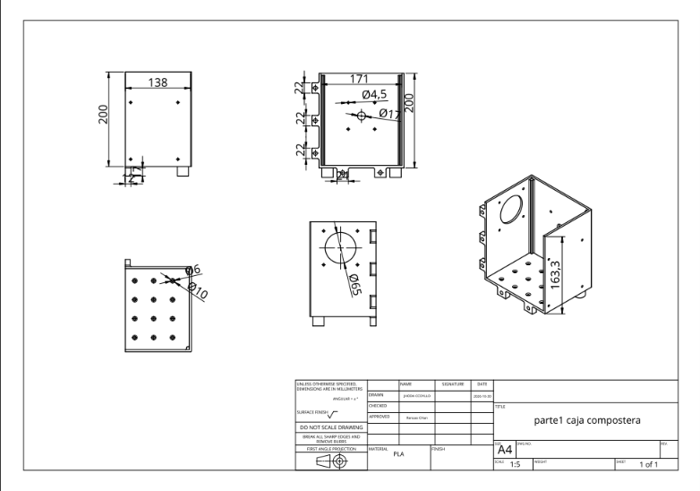
  
<em>Figura 10. Plano dimensional de la pieza Parte 1 de la caja compostera de CompostTech.</em>

> **Nota.** Elaboración propia en Onshape. Se detallan vistas ortogonales e isométrica, cotas de ensamble perimetral, correderas para falso fondo y rebajes de apoyo para el eje mezclador. Material: PLA. Cantidad requerida: 1 unidad. Cotas expresadas en milímetros.

---

##### 3.4.4.1.2. Plano dimensional de la pieza Parte 2 de la caja compostera
La pieza `parte2_caja_compostera` conforma la semicaja posterior del biorreactor, completando el volumen cerrado de reacción. Su diseño comparte la línea de partición simétrica con la Parte 1 y añade en sus caras exteriores elementos de integración funcional: cuatro salientes cilíndricas roscadas para el anclaje de la caja electrónica exterior, perforaciones pasamuros para cableado de sensores, aberturas para la difusión hacia la cámara del sensor de gases y la brida de montaje para el ventilador extractor.

El plano detalla vistas ortogonales e isométrica con dimensiones de 280 mm de longitud, 140 mm de fondo y 200 mm de altura exterior. Se indican orificios de fijación de 3,4 mm de diámetro, pasacables con reborde protector y un conducto circular de ventilación de 40 mm de diámetro.

  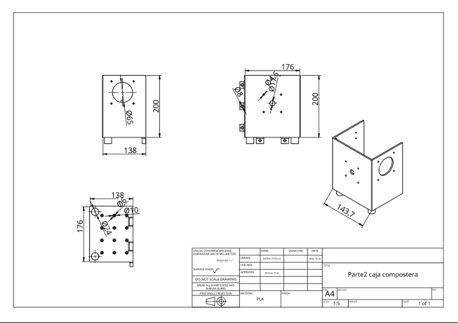
  
<em>Figura 11. Plano dimensional de la pieza Parte 2 de la caja compostera de CompostTech.</em>

> **Nota.** Elaboración propia en Onshape. Se presentan vistas ortogonales e isométrica, bridas de acople perimetral, salientes de fijación para gabinetes exteriores y ducto de extracción de aire. Material: PLA. Cantidad requerida: 1 unidad. Cotas expresadas en milímetros.

---

##### 3.4.4.1.3. Plano dimensional de la pieza Tapa de la compostera 
La pieza `tapa compos` corresponde al elemento de cerramiento superior de la cámara de compostaje. Su configuración presenta una placa rectangular de perfil reforzado con un reborde perimetral escalonado machihembrado que calza a presión sobre el borde de las semicajas, conteniendo las emanaciones gaseosas. La cara superior integra tiradores ergonómicos y ranuras de ventilación pasiva con deflector interno para mitigar la condensación sobre la superficie interior.

El plano establece dimensiones principales de 286 mm de largo, 186 mm de ancho y un espesor de placa de 4 mm, con un borde perimetral descendente de 12 mm de profundidad. Se detallan las cotas de las ranuras de aireación pasiva protegidas y las tolerancias dimensionales del canal de ajuste.

  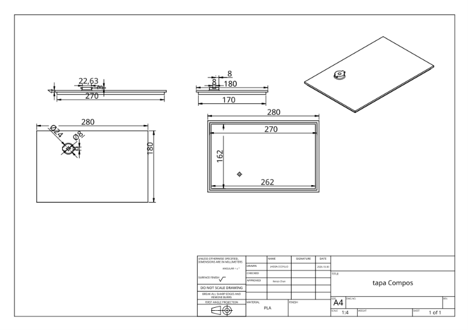
  
<em>Figura 12. Plano dimensional de la pieza Tapa de la compostera de CompostTech.</em>

> **Nota.** Elaboración propia en Onshape. Vistas ortogonales e isométrica, labio perimetral de estanqueidad, tiradores integrados y ranuras de ventilación pasiva. Material: PLA. Cantidad requerida: 1 unidad. Cotas expresadas en milímetros.

---

##### 3.4.4.1.4. Plano dimensional del recipiente recolector de lixiviados 
La pieza `recipiente lixiviados` presenta un compartimento prismático rectangular abierto en su parte superior, diseñado para deslizarse bajo el falso fondo de la compostera. Su geometría retiene hasta 1,85 L de efluentes decantados sin contacto con la biomasa sólida. Incorpora paredes con ángulo de desmolde ligero, un soporte vertical cilíndrico en una de sus esquinas para fijar el sensor de flotador magnético P45 y un labio frontal que facilita su extracción manual para labores de maceración externa.

El plano describe vistas ortogonales e isométrica con dimensiones exteriores principales de 220 mm de longitud, 120 mm de ancho y 70 mm de profundidad. Se especifican espesores de pared de 3 mm para garantizar impermeabilidad total frente a lixiviados ácidos, radios de curvatura en la base para facilitar el lavado y la cota de montaje del soporte del sensor de nivel.

  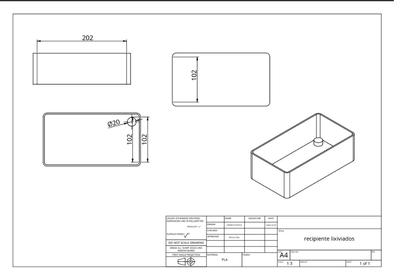
  
<em>Figura 13. Plano dimensional de la pieza Recipiente recolector de lixiviados de CompostTech.</em>

> **Nota.** Elaboración propia en Onshape. Vistas ortogonales e isométrica, cotas de volumen de retención (1,85 L), espesores de pared impermeable y soporte para flotador magnético. Material: PLA/PETG. Cantidad requerida: 1 unidad. Cotas expresadas en milímetros.

---

##### 3.4.4.1.5. Plano dimensional de la pieza Manivela 
La pieza `manivela` constituye el mecanismo de accionamiento manual del eje helicoidal de volteo. Presenta una configuración compuesta por un cubo de acople cilíndrico con orificio central chavetado para encaje rígido sobre el eje de 16 mm, un brazo radial de sección rectangular con nervadura lateral para resistir momentos torsores de hasta $15\text{ N}\cdot\text{m}$, y un eje secundario perpendicular en el extremo exterior que alberga una empuñadura cilíndrica giratoria.

El plano muestra vistas ortogonales e isométrica con una longitud entre centros de 95 mm, longitud total de 125 mm y un diámetro exterior del cubo de acople de 28 mm. Se indican cotas para un prisionero roscado radial M4, chavetero de 4 mm de ancho y detalles dimensionales del pasador del mango.

  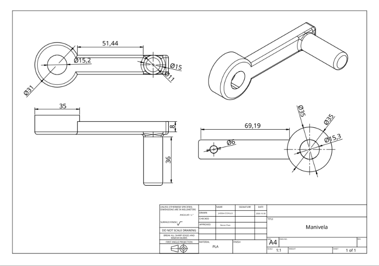
  
<em>Figura 14. Plano dimensional de la pieza Manivela de mezclado de CompostTech.</em>

> **Nota.** Elaboración propia en Onshape. Vistas ortogonales e isométrica, radio de giro, cubo de acople chavetado, nervadura de refuerzo y mango de accionamiento manual. Material: PLA. Cantidad requerida: 1 unidad. Cotas expresadas en milímetros.

---

##### 3.4.4.1.6. Plano dimensional de la abrazadera superior 
La pieza `abrasadera superior` presenta una geometría de medio anillo rígido con dos orejetas laterales planas de sujeción. Su función consiste en aprisionar los bujes de fricción o rodamientos del eje central contra la pared de la caja compostera, manteniendo la alineación horizontal durante el giro y absorbiendo las cargas radiales originadas por el volteo de los residuos.

El plano incluye vistas ortogonales e isométrica con una longitud entre extremos de 46 mm, ancho de 18 mm y una cavidad semicilíndrica central con radio de 10 mm. Cada orejeta lateral dispone de un barreno pasante de 3,4 mm de diámetro avellanado para tornillos M3, con cotas de separación entre centros de 34 mm.

  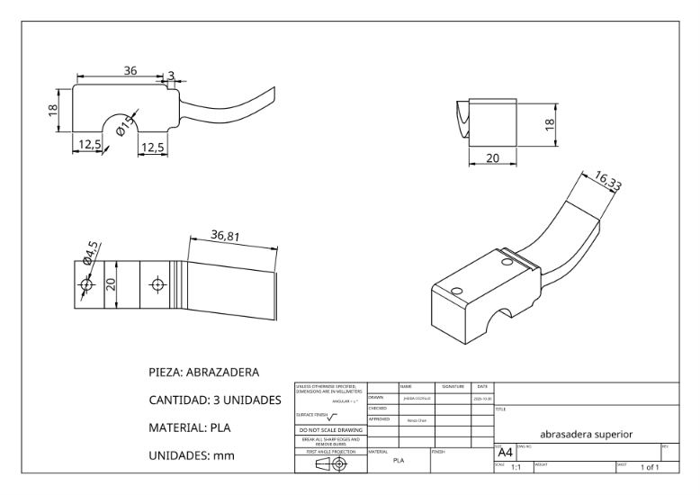
  
<em>Figura 15. Plano dimensional de la pieza Abrazadera superior de CompostTech.</em>

> **Nota.** Elaboración propia en Onshape. Vistas ortogonales e isométrica, cavidad de fijación para bujes de rodadura, orejetas de montaje y barrenos para tornillos M3. Material: PLA. Cantidad requerida: 2 unidades. Cotas expresadas en milímetros.

---

##### 3.4.4.1.7. Plano dimensional de la abrazadera inferior 
La pieza `abracadera inferior` constituye la mitad inferior complementaria del soporte de cojinete. Se acopla de manera invertida con la abrazadera superior, conformando un anillo completo que abraza el asiento del eje mezclador. Su cara inferior es plana para posarse de forma firme sobre el nervio correspondiente de la carcasa.

El plano muestra vistas ortogonales e isométrica con dimensiones de 46 mm de longitud total, 18 mm de ancho y una cavidad semicilíndrica central de radio de 10 mm. Incorpora dos perforaciones cilíndricas pasantes de 3,4 mm de diámetro alineadas de manera precisa con la pieza superior, especificando espesores de pared de 4 mm para evitar deformaciones por flexión bajo torque continuado.

  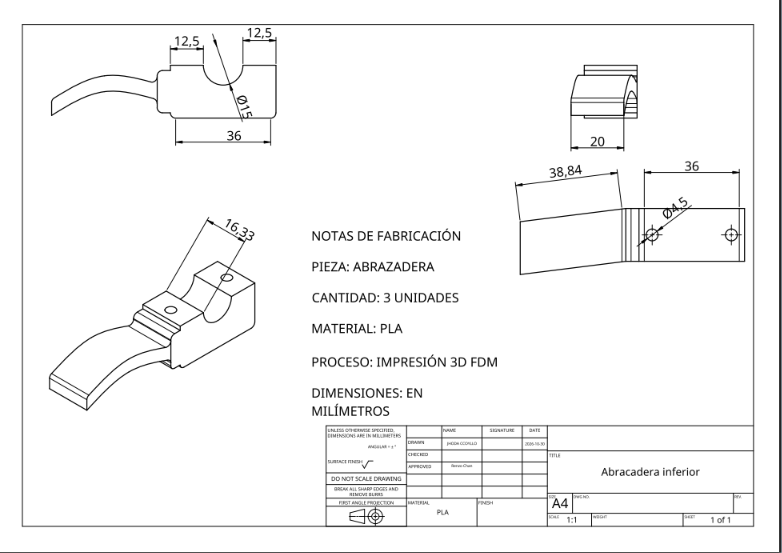
  
<em>Figura 16. Plano dimensional de la pieza Abrazadera inferior de CompostTech.</em>

> **Nota.** Elaboración propia en Onshape. Representación de vistas de alzado, planta y perfil, radio semicilíndrico de apoyo y barrenos de sujeción. Material: PLA. Cantidad requerida: 2 unidades. Cotas expresadas en milímetros.

---

##### 3.4.4.1.8. Plano dimensional de la pieza Collarín 
La pieza `collarin` presenta una estructura anular cilíndrica compacta destinada a fijarse sobre el cuerpo del eje central en las caras interiores de las paredes de la cámara. Su función técnica consiste en actuar como tope mecánico de retención axial, impidiendo cualquier desplazamiento longitudinal del eje o juego lateral durante las maniobras de giro con la manivela.

El plano describe vistas ortogonales e isométrica con un diámetro exterior de 26 mm, un diámetro interior calibrado de 16,2 mm para ajuste deslizante justo sobre el eje, y un espesor longitudinal de 10 mm. En una de sus caras cilíndricas se detalla una perforación roscada M4 perpendicular para la colocación de un prisionero de fijación con cabeza embutida.

  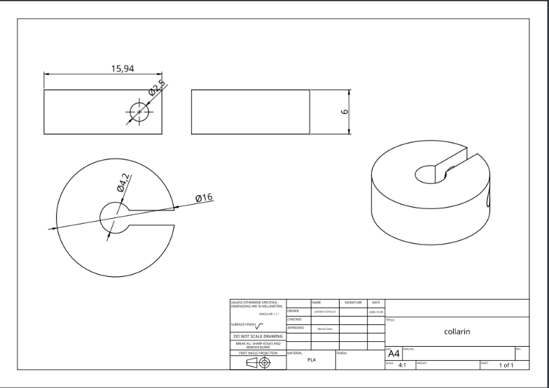
  
<em>Figura 17. Plano dimensional de la pieza Collarín de CompostTech.</em>

> **Nota.** Elaboración propia en Onshape. Vistas de sección y proyección isométrica, diámetros exterior e interior calibrados y detalle de rosca para prisionero axial. Material: PLA. Cantidad requerida: 2 unidades. Cotas expresadas en milímetros.

---

##### 3.4.4.1.9. Plano dimensional de la pieza Retenedor 
La pieza `retenedor` es un componente de geometría anular provisto de una brida circular delgada con orificios perimetrales de sujeción. Se monta adosada a la pared interna de paso del eje para retener un empaque elástico de nitrilo, evitando que partículas finas de biomasa o vapores condensados alcancen las pistas de los rodamientos y bujes exteriores.

El plano contiene vistas ortogonales e isométrica indicando un diámetro exterior de brida de 38 mm, diámetro del canal interior de retención de 20 mm, barreno central de 16,5 mm y un espesor general de 3,5 mm. Se detallan tres perforaciones avellanadas de 2,8 mm de diámetro distribuidas equiespaciadas a 120 grados para su fijación mediante tornillos autorroscantes.

  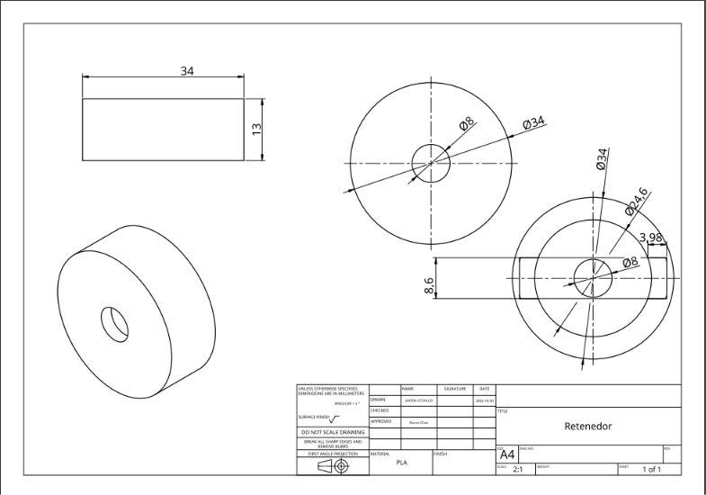
  
<em>Figura 18. Plano dimensional de la pieza Retenedor de CompostTech.</em>

> **Nota.** Elaboración propia en Onshape. Vistas ortogonales, sección con escalón para junta de estanqueidad y distribución angular de perforaciones de montaje. Material: PLA. Cantidad requerida: 2 unidades. Cotas expresadas en milímetros.

---

##### 3.4.4.1.10. Plano dimensional del soporte de rodaje 
La pieza `soporte rodaje` presenta un cuerpo cilíndrico robusto provisto de una pestaña base cuadrangular con cuatro orificios de sujeción. Su interior contiene un alojamiento cilíndrico rectificado para albergar rodamientos radiales sellados estándar 6003-2RS (diámetro exterior de 35 mm, diámetro interior de 17 mm) que guían el eje de la compostera reduciendo la fricción manual de mezclado.

El plano muestra vistas ortogonales e isométrica con una base de 52 mm por 52 mm, espesor de base de 5 mm y una copa cilíndrica sobresaliente de 40 mm de diámetro exterior con profundidad de alojamiento de 11 mm. Se indican cuatro perforaciones pasantes de 4,2 mm de diámetro para pernos de ensamble al chasis y un orificio central de paso para el extremo del eje.

  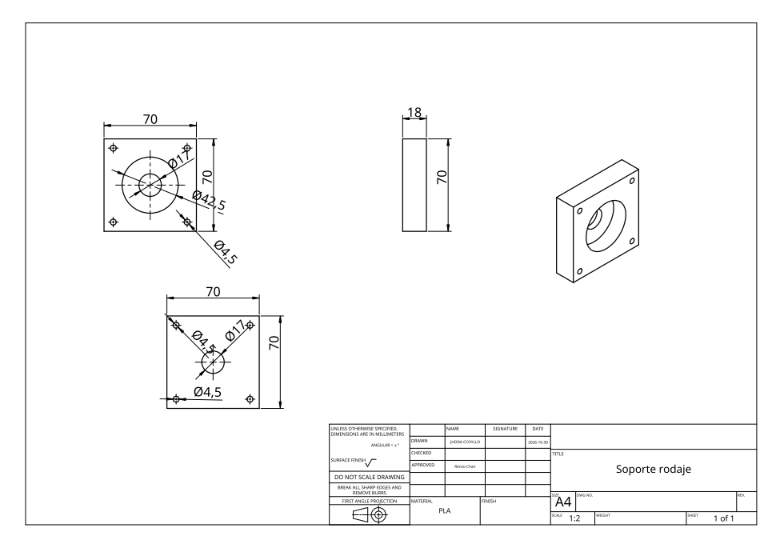
  
<em>Figura 19. Plano dimensional de la pieza Soporte de rodaje de CompostTech.</em>

> **Nota.** Elaboración propia en Onshape. Vistas de corte, cavidad de ajuste para rodamiento 6003-2RS, base cuadrangular y barrenos de fijación al chasis. Material: PLA. Cantidad requerida: 2 unidades. Cotas expresadas en milímetros.

---

##### 3.4.4.1.11. Plano dimensional de la tapa de rodaje 
La pieza `tapa rodaje` corresponde a un disco circular de perfil delgado con una pestaña perimetral que sella el extremo exterior del soporte de rodaje, protegiendo las pistas metálicas del rodamiento frente al ingreso de partículas de polvo ambiental o salpicaduras de líquidos.

El plano incluye vistas ortogonales e isométrica estableciendo un diámetro exterior de 42 mm, espesor de pared de 2,5 mm y un resalte anular interior de 34,6 mm de diámetro diseñado para encajar a presión en el alojamiento del soporte. En el plano de la tapa del lado ciego se presenta superficie continua, mientras que la del lado de tracción contempla un barreno central de paso de 16,5 mm para el acople de la manivela.

  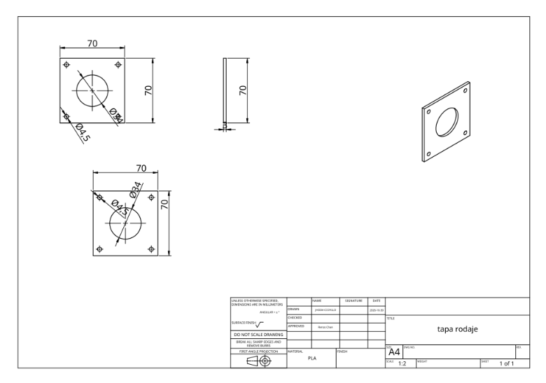
  
<em>Figura 20. Plano dimensional de la pieza Tapa de rodaje de CompostTech.</em>

> **Nota.** Elaboración propia en Onshape. Vistas de alzado y corte, labio de encaje a presión y opciones de cierre ciego y pasante para manivela. Material: PLA. Cantidad requerida: 2 unidades. Cotas expresadas en milímetros.

---

##### 3.4.4.1.12. Plano dimensional de la varilla estructural 1 
La pieza `varilla1` corresponde a una barra cilíndrica maciza de acero laminado calibrado (o PLA reforzado en prototipado preliminar) dispuesta longitudinalmente en la base del biorreactor para rigidizar la unión entre las dos semicajas y resistir la deflexión provocada por la masa húmeda en reposo.

El plano muestra la representación longitudinal y de sección, especificando una longitud total de 280 mm, un diámetro nominal de 8 mm y extremos dotados de roscas macho M8 en una longitud de 15 mm en cada extremo para su apriete con tuercas hexagonales exteriores.

  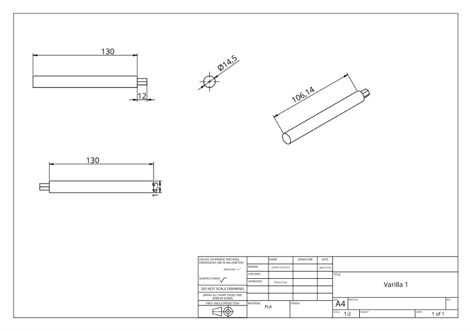
  
<em>Figura 21. Plano dimensional de la pieza Varilla estructural 1 de CompostTech.</em>

> **Nota.** Elaboración propia en Onshape. Vistas longitudinales, diámetro nominal de 8 mm, cotas de longitud de 280 mm y mecanizado de roscas en extremos. Material: Acero / PLA. Cantidad requerida: 2 unidades. Cotas expresadas en milímetros.

---

##### 3.4.4.1.13. Plano dimensional de la varilla estructural 2 
La pieza `varilla2` cumple la función de tirante transversal medio, atravesando la cámara en una posición calculada para mantener paralelas las caras laterales ante las tensiones dinámicas inducidas durante el volteo manual del compost.

El plano detalla una geometría cilíndrica maciza con una longitud total de 200 mm, diámetro de 8 mm y extremos mecanizados con filetes de rosca M8 de 12 mm de extensión, junto con chaflanes de entrada de 1 mm a 45 grados para facilitar su inserción en los orificios del chasis.

  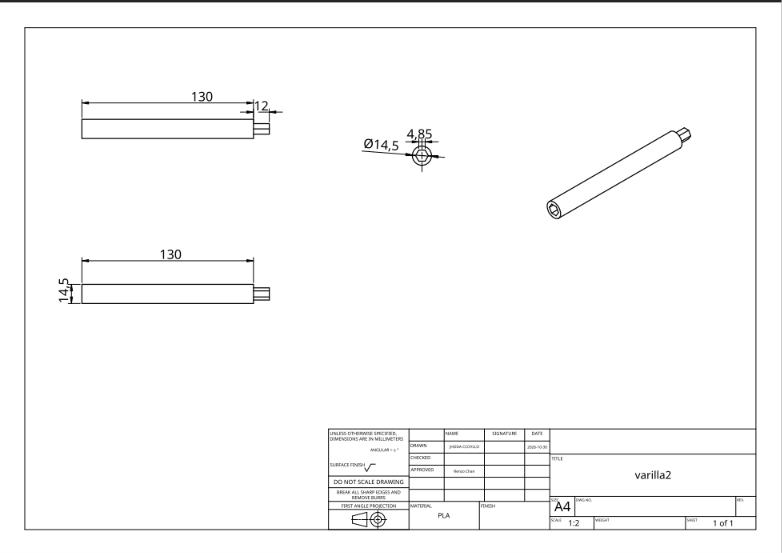
  
<em>Figura 22. Plano dimensional de la pieza Varilla estructural 2 de CompostTech.</em>

> **Nota.** Elaboración propia en Onshape. Dimensiones generales, longitud de 200 mm, diámetro de 8 mm y detalles de extremos roscados de arriostramiento. Material: Acero / PLA. Cantidad requerida: 2 unidades. Cotas expresadas en milímetros.

---

##### 3.4.4.1.14. Plano dimensional de la varilla estructural 3 
La pieza `varilla3` actúa como elemento de amarre superior, ubicada cerca del borde de apoyo de la tapa para evitar deformaciones en la embocadura del biorreactor producidas por ciclos térmicos termófilos.

El plano contiene las vistas de la varilla con una longitud total acotada de 180 mm, diámetro uniforme de 8 mm y extremos roscados M8 de 12 mm, acompañada de tolerancias dimensionales de rectitud para evitar desalineamientos en los ensambles laterales.

  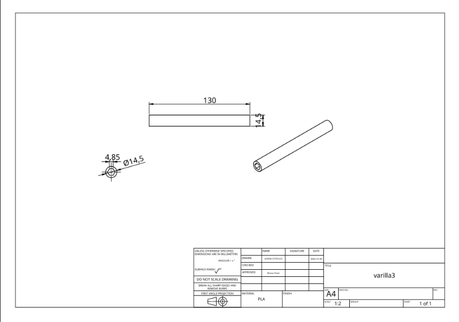
  
<em>Figura 23. Plano dimensional de la pieza Varilla estructural 3 de CompostTech.</em>

> **Nota.** Elaboración propia en Onshape. Vistas acotadas, longitud de 180 mm, diámetro de 8 mm y especificaciones de acabado superficial. Material: Acero / PLA. Cantidad requerida: 2 unidades. Cotas expresadas en milímetros.

---

#### 3.4.4.2. Planos dimensionales de los gabinetes electrónicos y montajes de sensórica

Los siguientes planos describen los gabinetes protectores, soportes en escuadra, marcos de visualización y ductos de ventilación encargados de albergar la PCB personalizada, los sensores abióticos y el actuador electromecánico de CompostTech. Se detallan individualmente las piezas `caja electronica`, `tapa electronico`, `carcasa mq135`, `tapa mq135`, `soporte mq135`, `soporte pantalla led` y `soporte ventilador`.

##### 3.4.4.2.1. Plano dimensional de la caja electrónica 
La pieza `caja electronica` presenta un compartimento prismático rectangular abierto por su cara frontal, diseñado para adosarse exteriormente a la semicaja posterior del reactor. Su volumen interno aloja de forma protegida la placa PCB de dos capas y el microcontrolador ESP32 DevKit V1. Su base interna incorpora cuatro postes cilíndricos con orificios ciegos para tornillos autorroscantes M3 que soportan la tarjeta electrónica, mientras que sus paredes laterales disponen de aberturas circulares escalonadas para la colocación de prensaestopas pasacables impermeables.

El plano establece dimensiones exteriores de 150 mm de longitud, 130 mm de ancho y 50 mm de profundidad total. Se especifican espesores de pared de 3 mm, un canal perimetral en el borde superior para alojar un cordón de caucho elastomérico de estanqueidad IP65 y cotas de espaciamiento entre los postes de la PCB de 100 mm por 70 mm.

  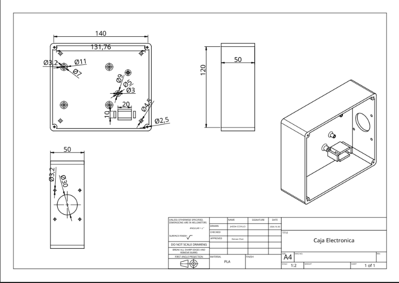
  
<em>Figura 24. Plano dimensional de la pieza Caja electrónica de CompostTech.</em>

> **Nota.** Elaboración propia en Onshape. Vistas ortogonales e isométrica, cavidad interior de 150 × 130 × 50 mm, postes de montaje para PCB, canal de sello IP65 y pasamuros de cableado. Material: PLA. Cantidad requerida: 1 unidad. Cotas expresadas en milímetros.

---

##### 3.4.4.2.2. Plano dimensional de la tapa de la caja electrónica
La pieza `tapa electronico` corresponde a la cubierta de cierre estanco del gabinete de control. Presenta una placa plana rectangular con esquinas redondeadas y cuatro barrenos avellanados situados en sus vértices, alineados con los insertos roscados de la caja principal. En su superficie exterior exhibe un relieve bajo con la identificación del proyecto.

El plano muestra vistas ortogonales e isométrica con dimensiones de 150 mm de largo, 130 mm de ancho y 4 mm de espesor uniforme. Se detallan las cotas de los cuatro orificios avellanados de 3,4 mm de diámetro para tornillos M3 con separación de centros de 138 mm por 118 mm, así como un reborde interior sobresaliente de 1,5 mm que comprime la junta de estanqueidad.

  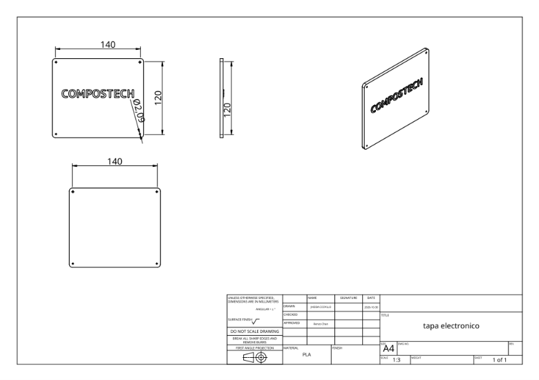
  
<em>Figura 25. Plano dimensional de la pieza Tapa de la caja electrónica de CompostTech.</em>

> **Nota.** Elaboración propia en Onshape. Vistas de alzado, perfil y detalle de avellanado para tornillos M3, reborde de compresión y dimensiones generales de 150 × 130 × 4 mm. Material: PLA. Cantidad requerida: 1 unidad. Cotas expresadas en milímetros.

---

##### 3.4.4.2.3. Plano dimensional de la carcasa periférica para sensor de gas 
La pieza `carcasa mq135` es un compartimento exterior específico concebido para aislar el sensor semiconductor MQ-135 de la condensación líquida directa proveniente del compost caliente. Presenta un volumen rectangular hueco con conductos ranurados orientados en ángulo hacia abajo que permiten la difusión gaseosa natural hacia el elemento calefactor de óxido de estaño ($SnO_2$) sin que las gotas de condensado ingresen a la cámara del sensor.

El plano describe vistas ortogonales e isométrica indicando dimensiones exteriores de 65 mm de largo, 55 mm de ancho y 40 mm de saliente. Se detallan las ranuras de aireación de 2,5 mm de espesor con inclinación de 45 grados, nervios internos de apoyo para el soporte del sensor y dos orejetas laterales con orificios de 3,4 mm para su atornillado directo sobre la pared del biorreactor.

  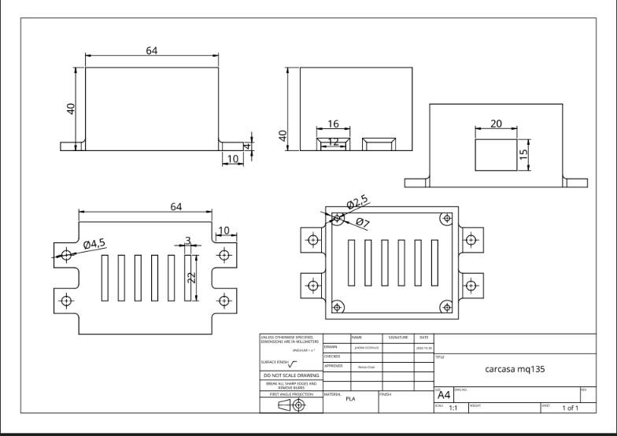
  
<em>Figura 26. Plano dimensional de la pieza Carcasa para sensor MQ-135 de CompostTech.</em>

> **Nota.** Elaboración propia en Onshape. Vistas ortogonales e isométrica, conductos ranurados en ángulo para difusión pasiva de gases y puntos de anclaje exterior. Material: PLA. Cantidad requerida: 1 unidad. Cotas expresadas en milímetros.

---

##### 3.4.4.2.4. Plano dimensional de la tapa de la carcasa MQ-135 
La pieza `tapa mq135` actúa como elemento desmontable de inspección y calibración para la cámara periférica de gases. Permite acceder directamente al potenciómetro de ajuste de resistencia de carga del sensor MQ-135 sin desmontar la estructura principal de la compostera.

El plano contiene vistas ortogonales e isométrica con dimensiones de 65 mm de largo, 55 mm de ancho y 3 mm de espesor. Incorpora dos perforaciones avellanadas de 3,2 mm de diámetro en los extremos y un resalte guía que encaja dentro del cuerpo de la carcasa para evitar desalineamientos.

  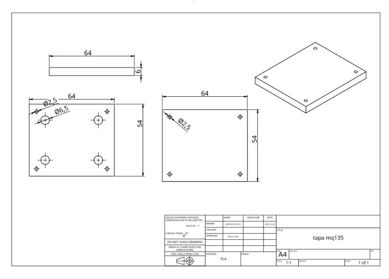
  
<em>Figura 27. Plano dimensional de la pieza Tapa de la carcasa MQ-135 de CompostTech.</em>

> **Nota.** Elaboración propia en Onshape. Vistas ortogonales, espesores, pestaña guía de ajuste y perforaciones de sujeción para mantenimiento. Material: PLA. Cantidad requerida: 1 unidad. Cotas expresadas en milímetros.

---

##### 3.4.4.2.5. Plano dimensional del soporte interno para sensor MQ-135 
La pieza `soporte mq135` es una estructura en escuadra con ranuras calibradas de encaje que se introduce dentro de la carcasa periférica. Su función es inmovilizar la pequeña placa PCB comercial del sensor MQ-135, manteniendo la malla metálica del elemento calefactor orientada hacia el flujo de gases y alejando sus terminales de soldadura de las paredes plásticas.

El plano incluye vistas ortogonales e isométrica con dimensiones generales de 40 mm de longitud, 35 mm de ancho y 12 mm de altura. Se especifican pestañas de retención elástica tipo *snap-fit*, una ventana central libre para la disipación del calefactor del sensor y dos taladros de fijación de 2,5 mm de diámetro.

  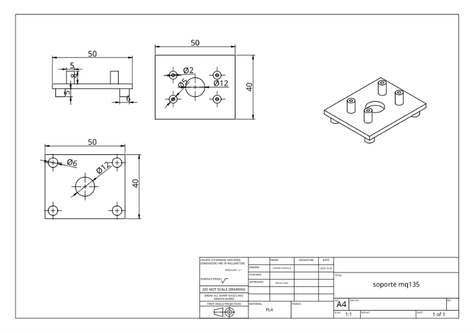
  
<em>Figura 28. Plano dimensional de la pieza Soporte para sensor MQ-135 de CompostTech.</em>

> **Nota.** Elaboración propia en Onshape. Vistas acotadas, ranuras de encaje para placa de sensor, ventana de disipación y pestañas de fijación. Material: PLA. Cantidad requerida: 1 unidad. Cotas expresadas en milímetros.

---

##### 3.4.4.2.6. Plano dimensional del soporte para pantalla OLED 
La pieza `soporte pantalla led` (destinada a la pantalla OLED monocromática) corresponde a un bisel frontal empotrado diseñado para ubicarse en la cara superior o lateral del biorreactor. Dispone de un marco exterior con ventana rectangular abierta que deja visible el área activa del display OLED SSD1306, mientras que por la parte posterior incorpora cuatro postes pequeños con rebajes para encajar la placa electrónica y proteger los pines de conexión I2C.

El plano muestra vistas ortogonales e isométrica con dimensiones de placa de 48 mm de largo por 38 mm de alto y un espesor de marco de 6 mm. Se detalla la ventana de visualización central acotada en 32 mm por 18 mm, así como cuatro perforaciones ciegas de 2 mm de diámetro espaciadas a 24 mm y 30 mm para microtornillos M2.

  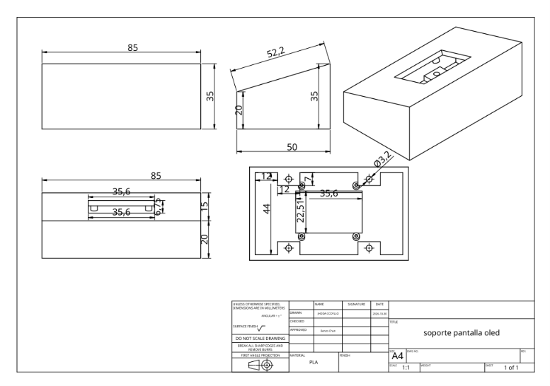
  
<em>Figura 29. Plano dimensional de la pieza Soporte para pantalla OLED de CompostTech.</em>

> **Nota.** Elaboración propia en Onshape. Vistas de alzado, corte y perspectiva, ventana gráfica de visualización del avatar y postes de fijación para display OLED I2C. Material: PLA. Cantidad requerida: 1 unidad. Cotas expresadas en milímetros.

---

##### 3.4.4.2.7. Plano dimensional del soporte para ventilador extractor
La pieza `soporte ventilador` es un ducto de transición aerodinámica cuadrangular diseñado para montar el ventilador axial de 12 V DC (formato estándar de 80 mm por 80 mm o 40 mm por 40 mm) sobre la pared lateral del biorreactor. Incorpora una rejilla de protección frontal con orificios hexagonales tipo panal que permite la salida libre del caudal de aire caliente impidiendo que fragmentos de biomasa alcancen las aspas rotatorias del motor.

El plano establece vistas ortogonales e isométrica con dimensiones exteriores de 85 mm por 85 mm y una profundidad de tobera de 18 mm. Se detallan cuatro orificios pasantes de 4,2 mm de diámetro con separación entre centros estándar de 71,5 mm para pernos M4 con tuerca autofrenante, así como el espesor de 1,8 mm de las celdas hexagonales de la rejilla de seguridad.

  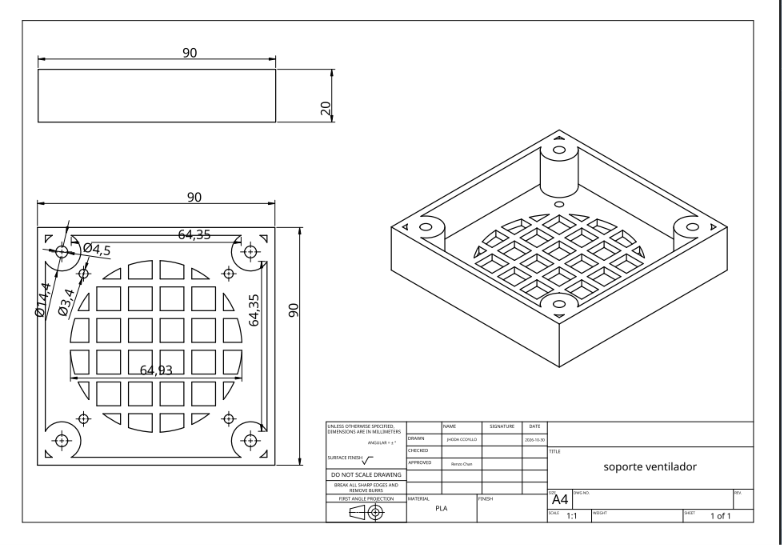
  
<em>Figura 30. Plano dimensional de la pieza Soporte para ventilador extractor de CompostTech.</em>

> **Nota.** Elaboración propia en Onshape. Vistas ortogonales e isométrica, marco cuadrangular de montaje para ventilador axial, rejilla hexagonal de protección y barrenos para pernos M4. Material: PLA. Cantidad requerida: 1 unidad. Cotas expresadas en milímetros.

### 3.5. Diseño electrónico y acondicionamiento en PCB de CompostTech

Para el sistema de control y adquisición de CompostTech se desarrolló un esquemático electrónico y el diseño de una placa de circuito impreso (PCB) personalizada de dos capas mediante EasyEDA Pro[cite: 5, 8]. Este subsistema tiene como finalidad acondicionar las señales provenientes de los sensores instalados en la biomasa y en la estructura, gestionar el accionamiento electromecánico de la ventilación forzada y distribuir los niveles de tensión requeridos por el microcontrolador y los periféricos.

#### Esquemático electrónico de CompostTech

El esquemático se organiza en cinco bloques funcionales principales: control y procesamiento, adquisición y acondicionamiento de señales, etapa de potencia y ventilación, interfaz de visualización y distribución de alimentación, como se presenta en la Figura 2[cite: 5].

* **Control y procesamiento:** La unidad central corresponde al microcontrolador ESP32 DevKit V1 (30 pines), encargado de digitalizar las lecturas analógicas, procesar la lógica de control con histéresis, gestionar la comunicación I2C y transmitir la información de telemetría[cite: 5].
* **Adquisición y acondicionamiento de señales:** El diseño contempla conectores tipo 2510 para enlazar los sensores abióticos[cite: 5]:
  - *Humedad en biomasa:* Dos conectores independientes (2510-3A) asignados a los niveles superior e inferior, enlazados a los canales de conversión analógica-digital D34 y D35 del microcontrolador[cite: 5].
  - *Gases en cámara periférica:* Conector (2510-4A) para el sensor semiconductor MQ-135, el cual incorpora un divisor resistivo de tensión formado por R1 (10 kΩ) y R3 (10 kΩ) que acopla el nivel de salida al rango seguro del pin ADC D32 (máximo 3,3 V)[cite: 5].
  - *Temperatura en núcleo:* Conector (2510-3A) para la sonda digital sumergible DS18B20, que implementa el bus OneWire en el pin D4 con su respectiva resistencia de elevación (*pull-up*) R2 (4,7 kΩ) conectada a la línea de 3,3 V[cite: 5].
  - *Nivel de lixiviados:* Conector (2510-2A) para el flotador magnético en la bandeja inferior, conectado al pin digital D5 a través de una red de filtrado pasivo antirrebote integrada por R4 (10 kΩ), R5 (1 kΩ) y el condensador de desacoplo C1 (100 nF)[cite: 5].
* **Etapa de potencia y ventilación:** Para accionar el ventilador extractor de 12 V DC se implementó un circuito de conmutación en emisor común basado en el transistor BJT NPN 2N2222 (Q1)[cite: 5]. La conmutación es gobernada desde el pin digital D23 del ESP32 a través de una resistencia de polarización de base R7 (1 kΩ)[cite: 5]. En paralelo con la bornera de conexión del ventilador (FAN_12V), se colocó el diodo Schottky 1N5819 (D4) en polarización inversa (*flyback*), protegiendo al semiconductor contra sobretensiones transitorias producidas por la inductancia del motor[cite: 5].
* **Interfaz de visualización:** Dispone de un conector hembra de 4 pines enlazado a las líneas de comunicación I2C del microcontrolador (SCL en el pin D22 y SDA en el pin D21), proporcionando alimentación de 3,3 V y referencia de tierra para el funcionamiento de la pantalla OLED local[cite: 5].
* **Bloque de alimentación:** La placa integra borneras de tornillo independientes para la entrada de batería/fuente lógica de 5 V (BATTERY/VIN), la entrada de alimentación externa de 12 V (12V_IN) para la etapa de extracción y una salida auxiliar regulada de 3,3 V (3V3_OUT), garantizando la separación de líneas de potencia y señal[cite: 5].
  

  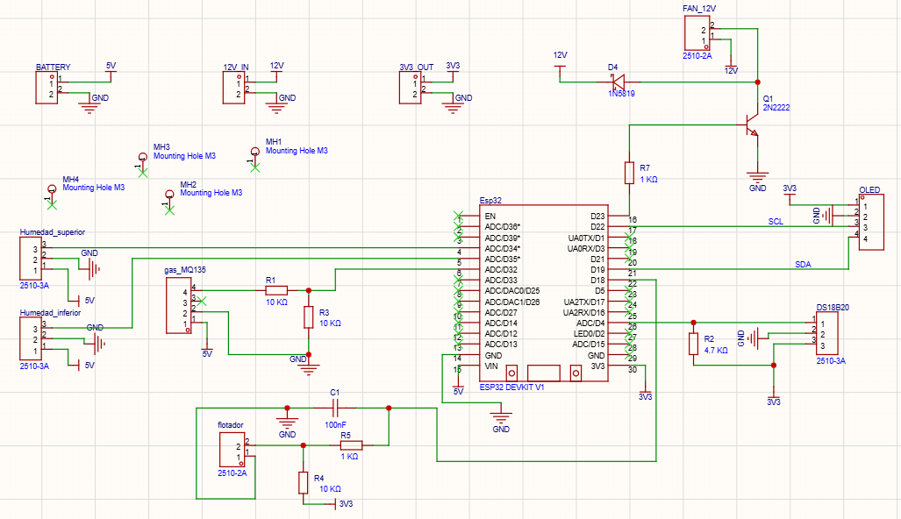

*Figura 31. Esquemático electrónico del sistema de monitoreo CompostTech.*[cite: 5]

*Nota.* Elaboración propia en EasyEDA Pro[cite: 5]. Se presentan los bloques funcionales de control (ESP32 DevKit V1), acondicionamiento de sensores (DS18B20, humedad dual, MQ-135 y flotador), etapa de conmutación para ventilador de 12 V, interfaz I2C para pantalla OLED y bornes de alimentación[cite: 5].

---

#### Diseño de la placa PCB ruteada de CompostTech

A partir del esquemático electrónico se elaboró el diseño de una placa de circuito impreso (PCB) personalizada de dos capas (Top y Bottom Layer), en la cual se distribuyeron las huellas de los componentes, las áreas de potencia y las pistas de interconexión eléctrica, como se muestra en la Figura 3[cite: 6, 8].

En la sección central de la placa se ubican los zócalos destinados al microcontrolador ESP32 DevKit V1, permitiendo su montaje y desmontaje seguro[cite: 6, 7]. A la izquierda de la placa se agruparon las conexiones de los sensores analógicos de humedad y gases, manteniendo trayectorias de pista cortas hacia los pines ADC del controlador[cite: 6]. En el lateral derecho se colocaron las interfaces digitales para el sensor DS18B20, la pantalla OLED y el circuito del flotador, optimizando el ruteo de señales de baja frecuencia[cite: 6].

La etapa de conmutación de potencia (transistor 2N2222, diodo flyback 1N5819 y borneras de 12 V) se ubicó deliberadamente en la esquina superior derecha, aislada de las líneas de datos sensibles para mitigar interferencias electromagnéticas inducidas por el arranque del ventilador[cite: 6]. Asimismo, la placa cuenta con cuatro perforaciones metalizadas (MH1 a MH4) para tornillos M3 en los vértices, asegurando su fijación mecánica dentro de la caja de control de PLA adosada al biorreactor[cite: 5, 6].

El diseño fue verificado mediante la herramienta de Verificación de Reglas de Diseño (DRC) en EasyEDA Pro, registrando cero errores y cero advertencias antes de la generación de los archivos Gerber para su fabricación. Esta integración en PCB elimina el cableado suelto tradicional en prototipos de desarrollo, garantizando la estabilidad operativa del hardware y facilitando el mantenimiento modular del sistema.

  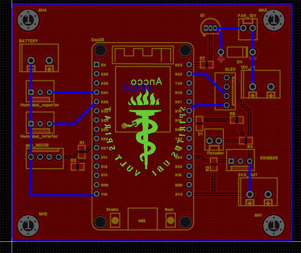

*Figura 32. Diseño de la placa de circuito impreso (PCB) personalizada de CompostTech.*[cite: 6, 8]

*Nota.* Elaboración propia en EasyEDA Pro[cite: 6, 8]. Se muestra la distribución espacial de los conectores perimetrales tipo 2510, el zócalo para el ESP32 DevKit V1, las pistas ruteadas en doble cara, la etapa de conmutación de 12 V y los puntos de montaje para su instalación física[cite: 6, 7, 8].

#### 3.6. Arquitectura del software y propuesta de interfaz de usuario
La aplicación móvil desarrollada en Flutter constituye el entorno de visualización y gestión remota del sistema:

* **Módulo de autenticación:** Implementado mediante `FirebaseAuth`, permite el registro e inicio de sesión de los usuarios tanto por credenciales directas (correo/contraseña) como a través del proveedor de identidad de Google. Cada cuenta queda unívocamente vinculada al identificador universal `UID` generado por el servicio de autenticación.
* **Persistencia local segmentada:** Los perfiles de usuario y parámetros de configuración se almacenan localmente en el dispositivo utilizando `SharedPreferences`, aislando la información de cada usuario mediante claves indexadas con su respectivo identificador (`compostech_profile_v1_${user.uid}`).
* **Panel de telemetría y avatar interactivo:** La pantalla principal presenta un panel con cuatro tarjetas de monitoreo en tiempo real (temperatura en °C, porcentaje de humedad del sustrato, estado de proliferación de gases y nivel de lixiviados en bandeja). La parte central exhibe el avatar ilustrado, cuya expresión gráfica y colorimetría alertan visualmente sobre intervenciones requeridas (riego, incorporación de estructurante seco, mezclado con manivela o vaciado de efluentes).

---
#### 3.7. Arquitectura del software y propuesta de interfaz de usuario

La aplicación móvil desarrollada en Flutter constituye el entorno de visualización, asistencia operativa y gestión remota del biorreactor CompostTech:

* **Módulo de autenticación y acceso:** Implementado mediante `FirebaseAuth`, permite el registro e inicio de sesión seguro de los usuarios a través de credenciales directas (correo electrónico y contraseña) o mediante el proveedor de identidad de Google. Cada cuenta queda vinculada al identificador universal `UID` generado por el servicio de autenticación, asegurando la trazabilidad y la privacidad de los registros.

  

*Figura 33. Propuesta de interfaz del módulo de autenticación y acceso de CompostTech.*

*Nota.* Elaboración propia en Flutter. Representación de las pantallas de registro e inicio de sesión con soporte para correo/contraseña y autenticación mediante Google, gestionadas a través de `FirebaseAuth`.

* **Persistencia local segmentada:** Los perfiles de usuario y parámetros de configuración se almacenan localmente en el dispositivo utilizando `SharedPreferences`, aislando la información de cada cuenta mediante claves indexadas con su respectivo identificador (`compostech_profile_v1_${user.uid}`).
* **Panel de telemetría y avatar interactivo:** La pantalla principal (*Home*) despliega un panel organizado en cuatro tarjetas interactivas que presentan las lecturas en tiempo real: temperatura del núcleo (en °C), humedad del sustrato (en %), índice de proliferación de gases y estado del nivel de lixiviados en la bandeja inferior. En la sección central se ubica el avatar dinámico de tres estados, cuya expresión gráfica y colorimetría alertan visualmente sobre intervenciones requeridas (riego, incorporación de estructurante seco, mezclado manual con manivela o vaciado de efluentes para maceración).

  

*Figura 34. Propuesta de interfaz del panel principal (Home) y telemetría de CompostTech.*

*Nota.* Elaboración propia en Flutter. Representación del panel de monitoreo con las tarjetas de variables abióticas (temperatura, humedad, gases y lixiviados) y la visualización central del avatar interactivo para la asistencia al usuario.

#### 3.7.1. Recorrido preliminar del usuario en el aplicativo CompostTech

Como complemento del diseño preliminar de la interfaz, se propone el recorrido del usuario dentro del aplicativo **CompostTech**, con la finalidad de representar las principales acciones que permitirían supervisar el proceso de compostaje doméstico. Este recorrido muestra cómo el usuario accedería a las mediciones obtenidas mediante sensores IoT y utilizaría la información disponible para tomar decisiones sobre el mantenimiento de la compostera.

El recorrido inicia con el ingreso al aplicativo, desarrollado en Flutter, y el acceso al panel principal, donde se presentaría el estado general del compost mediante una mascota virtual interactiva. Asimismo, se visualizarían las mediciones de **temperatura, humedad, gases y nivel de lixiviados**, obtenidas por los sensores conectados al ESP32 y almacenadas en Firebase.

Posteriormente, el usuario podría consultar la fase estimada del compostaje, considerando las etapas mesófila, termófila, enfriamiento y maduración. De manera complementaria, se contempla incorporar un módulo de **Machine Learning** que permita interpretar las mediciones históricas, identificar comportamientos anómalos y generar recomendaciones según las condiciones del proceso. Esta funcionalidad estaría sujeta al entrenamiento y validación del modelo con datos experimentales.

Asimismo, el aplicativo permitiría visualizar alertas y recomendaciones relacionadas con el riego, la incorporación de material seco, el volteo manual y el retiro de lixiviados. También se podrían consultar gráficas históricas, comparar mediciones anteriores y revisar reportes resumidos sobre la evolución del compostaje.

Finalmente, el usuario podría decidir si requiere realizar alguna intervención o continuar con el monitoreo, regresando posteriormente al panel principal o finalizando su sesión.

La **Figura 35** presenta el recorrido preliminar del usuario en CompostTech, desde el ingreso al aplicativo hasta la interpretación de los parámetros y el apoyo a la toma de decisiones durante el proceso de compostaje.

  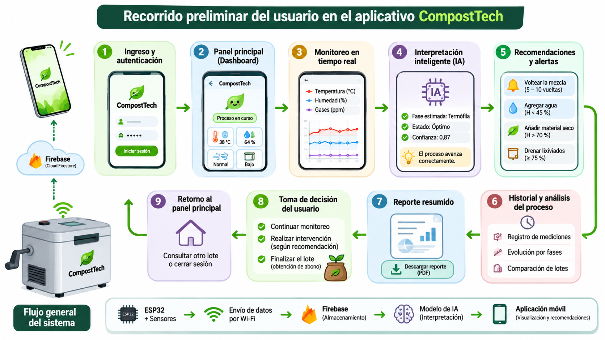

*Figura 35.** *Recorrido preliminar del usuario en el aplicativo CompostTech.*

**Nota.** Elaboración propia. Se representa el recorrido conceptual del usuario en CompostTech, incluyendo monitoreo de sensores, identificación de fases, alertas, recomendaciones e historial. Las funcionalidades basadas en Machine Learning se encuentran sujetas a desarrollo y validación experimental.
---
### Referencias bibliográficas 

[1] Consejo Nacional de Ciencia, Tecnología e Innovación Tecnológica (CONCYTEC), *Directiva N.º 001-2022-CONCYTEC-P: Uso de la metodología Nivel de Madurez Tecnológica (TRL)*, Resolución de Presidencia N.º 020-2022-CONCYTEC-P, Lima, Perú, 2022.

[2] P. Román, M. M. Martínez y A. Pantoja, *Manual de compostaje del agricultor: Experiencias en América Latina*, Santiago de Chile: Organización de las Naciones Unidas para la Alimentación y la Agricultura (FAO), 2013, pp. 21–35, 65.

[3] T. L. Richard y N. M. Trautmann, "Moisture content and C:N ratio calculations in composting," Cornell Waste Management Institute, Cornell University, Ithaca, NY, Tech. Rep., 1996.

[4] G. Vrettos, G. Kazamias y D. F. Lekkas, "Smart compost monitoring system using open source technologies," en *Proc. 15th Int. Conf. Environ. Sci. Technol. (CEST2017)*, Rhodes, Greece, 2017, art. CEST2017_01427.

[5] A. G. Naser, N. M. Nawi, M. R. Zakaria, M. S. M. Kassim, A. A. Mutalovich y K. K. Katibi, "Design and implementation of an integrated sensor network for monitoring abiotic parameters during composting," *Sustainability*, vol. 17, n.º 21, art. 9780, nov. 2025, doi: 10.3390/su17219780.

[6] G. Rajamuneeswaran, P. Hridhya, B. Sakthivel y N. Gayathri Bai, "Smart Compost Guardian: An IoT-based real-time compost monitoring and alert system," *Int. J. Eng. Res. Technol.*, vol. 13, n.º 5, pp. 1–5, jun. 2025, doi: 10.17577/IJERTCONV13IS05027.

[7] B. Liu, K. Zhang, Y. Wei, G. Ding, T. Xu, L. Zhang y J. Li, "Towards data-driven smart composting techniques and control systems," *Bioresour. Technol.*, vol. 440, art. 133514, feb. 2026, doi: 10.1016/j.biortech.2025.133514.

[8] A. Al-Fuqaha et al., "Compost monitoring system for kitchen waste management: Development, deployment and analysis," *IoT*, vol. 6, n.º 4, art. 64, oct. 2025, doi: 10.3390/iot6040064.

[9] Comisión de la Comunidad Andina, *Decisión 486: Régimen Común sobre Propiedad Industrial*, Lima, Perú, 2000.

[10] A. J. Baxter, "Compost monitoring device and system," Solicitud de Patente Internacional WO 2021/081597 A1, 6 de mayo de 2021.

[11] A. F. DiPaola y M. J. DiPaola, "Low-power composting monitor," Patente EE. UU. US 12 189 458 B2, 7 de enero de 2025.

[12] J. S. T. Adams, "Automated food waste composter and method," Solicitud de Patente EE. UU. US 2021/0371348 A1, 2 de diciembre de 2021.

[13] L. Zhang, "Household aerobic composting device with leachate separation," Patente de Modelo de Utilidad China CN 212832860 U, 30 de marzo de 2021.

[14] Ministerio del Ambiente (MINAM), *Reporte de Generación y Composición de Residuos Sólidos Municipales – SIGERSOL*, Lima, Perú, 2023.

[15] Espressif Systems, *ESP32-WROOM-32D / ESP32-WROOM-32U Datasheet*, Versión 3.5, Shanghái, China, 2024.

[16] Analog Devices, *DS18B20: Programmable Resolution 1-Wire Digital Thermometer*, Datasheet 19-7487, Norwood, MA, EE. UU., 2019.

[17] Zhengzhou Winsen Electronics Technology Co., Ltd., *MQ135 Semiconductor Sensor for Air Quality Control*, Manual Ver. 1.4, Zhengzhou, China, 2015.

[18] ON Semiconductor, *2N2222A General Purpose Transistor NPN*, Semiconductor Component Industries, Phoenix, AZ, EE. UU., Datasheet 2N2222A/D, 2019.

[19] Solomon Systech Limited, *SSD1306: 128 x 64 Dot Matrix OLED/PLED Segment/Common Driver with Controller*, Rev. 1.1, Hong Kong, 2018.

[20] M. P. Ho, H. Wang, J. H. Lee, C. K. Ho, K. T. Lau, J. Leng y D. Hui, "Critical factors on manufacturing processes of natural fibre composites," *Composites Part B: Eng.*, vol. 43, n.º 8, pp. 3549–3562, dic. 2012, doi: 10.1016/j.compositesb.2011.10.001.

[21] M. Lazrak, G. Ait Baddi, F. Achemchem, J. Ayour, S. Zaidouni y B. Chebli, "AI-driven and sensor-based composting in a connected bioreactor: A novel framework for predicting maturity and quality dynamics," Waste Manage. Bull., vol. 3, n.º 4, art. 100254, dic. 2025.
