# PRUEBA Y CALIBRACIÓN DE SENSORES — TRL 3

## Desarrollo experimental o prueba del concepto tecnológico

> **Proyecto:** CompostTech (Monitor de Compostaje Doméstico Inteligente)

| Campo | Información |
| :--- | :--- |
| **Curso** | Proyecto Integrador 2026-II |
| **Integrantes** | Jhunior Moieses Aliaga Cueva; Leonela Angela Aldana Porras; Juan Carlo Ancco Quispe; Alex Jhosep Ccoyllo Sotelo; Ruth Carina Turpo Cayo |
| **Ingenieros** | Umbert Lewis De La Cruz, María Rejas, Harry Rivera y Renzo Chan |
| **Fecha de actualización** | 08/11/2026 |
| **Institución** | Universidad Peruana Cayetano Heredia |
| **Tema** | TRL 3 de Monitor de Compostaje Doméstico Inteligente |

## Contenido

En este nivel se ejecuta la Prueba de Concepto Tecnológico para el sistema de monitoreo y control automatizado de compostaje (**CompostTech**). El objetivo principal es demostrar mediante ensayos experimentales a nivel de laboratorio la viabilidad de la adquisición de datos fisicoquímicos (temperatura, humedad del sustrato, niveles de lixiviados y gases metabólicos $\text{CO}_2/\text{NH}_3$) y la respuesta del sistema de ventilación forzada para optimizar el bioproceso de descomposición orgánica aerobia.

## 1. Descripción del Sistema y Ciclo Operativo

El sistema recibe una masa aproximada de **2,3 a 2,5 kg** de biomasa orgánica (restos vegetales domésticos y de poda) en el contenedor de compostaje y monitorea continuamente los parámetros fisicoquímicos clave del bioproceso: temperatura, humedad del sustrato, concentración de gases y nivel de lixiviados[1,2]. Un microcontrolador **ESP32 DevKit V1** procesa estas señales mediante un algoritmo de decisión por umbrales para coordinar la aireación forzada y notificar alertas al usuario[3,4]. En el **TRL 3** se evalúan y prueban individualmente los elementos que miden y accionan este ciclo:
- **Sensor de temperatura (DS18B20 impermeable):** Entrada principal para identificar las fases mesófila (20–35 °C) y termófila (35–65 °C), y activar la ventilación si supera los 65 °C[2].
- **Sensor de humedad capacitivo (v1.2):** Mide el porcentaje de humedad del sustrato para mantener el rango óptimo (50–70 %)[3].
- **Sensores de gases (SCD41 / MQ-135):** Monitorean la concentración de $\text{CO}_2$ y gases metabólicos u olores ($\text{NH}_3$)[4].
- **Sensor de nivel de lixiviados (XKC-Y25-T12V sin contacto):** Detecta la acumulación del efluente líquido en la base del contenedor de forma no intrusiva[5].
- **Ventilador USB (8025 5V - $80 \times 80 \times 25\text{ mm}$):** Actuador encargado del flujo de aire forzado ante sobrecalentamiento o exceso de gases[1].
- **ESP32 DevKit V1 y Alimentación (Power Bank de 20 000 mAh):** Núcleo de procesamiento, conectividad y fuente de energía segura a 5 V DC[3].

## 2. Ensayos analíticos y simulación estructural en SimScale

El análisis estructural se centró en evaluar la integridad del prototipo **Compostech** (conjunto recipiente-eje-chasis) bajo la carga estática asociada al peso estimado de la materia orgánica en proceso de compostaje.

**Parámetros de Entrada y Configuración del Escenario Simulado:**
*   **Plataforma de Simulación:** SimScale (Análisis estructural estático).
*   **Carga Aplicada:** Fuerza vertical de $91.8\text{ N}$ aplicada sobre la cara interna inferior del recipiente. Esto equivale a una masa aproximada de $9.36\text{ kg}$ ($\approx 91.8\text{ N} / 9.81\text{ m/s}^2$).
*   **Materiales Asignados:** Recipiente principal en HDPE (Polietileno de Alta Densidad), eje central/chasis en Acero AISI 304 y componentes impresos en PLA.
*   **Condiciones de Contorno (Apoyos):** *Fixed Support* (apoyos fijos) en las cuatro patas del recipiente estructural y restricciones de rodadura en los soportes del eje.

---

### 2.1. Visualización General de Esfuerzos (Von Mises)

La primera etapa del análisis evalúa la distribución del esfuerzo equivalente de Von Mises en todo el ensamblaje bajo el escenario estático reportado, verificando que la respuesta mecánica trabaje en rangos seguros.

  

> **Figura 2.1:** `simscale_von_mises.png`. Mapa de calor de esfuerzos de Von Mises. El rango cromático indica la intensidad del esfuerzo en MPa, evidenciando que la mayor parte de la estructura opera en rangos seguros (azul/verde), muy por debajo del límite de fluencia del HDPE y del acero.

---

### 2.2. Identificación de Puntos Críticos y Concentraciones de Esfuerzo

Para asegurar la durabilidad del sistema, se analizaron las zonas donde los esfuerzos se concentran (*hotspots*), tales como uniones, filamentos de esquina, soportes de rodamientos y bordes inferiores del recipiente.

  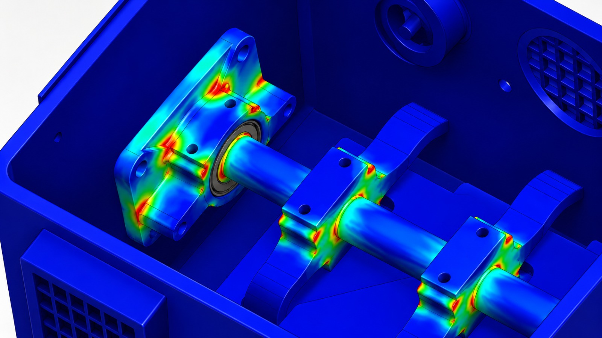

> **Figura 2.2:** `simscale_stress_concentrations.png`. Vista detallada (*zoom*) que resalta las zonas de máximo esfuerzo ($\sigma_{max}$). Identificar estas áreas permite validar el diseño de componentes críticos como el eje de transmisión y sus soportes de rodamiento, asegurando un Factor de Seguridad ($FS$) adecuado.
---

### 2.3. Análisis de Desplazamiento y Deformación Estructural

Además de la resistencia a la fluencia, la estructura no debe deformarse excesivamente para garantizar la correcta alineación del eje de rotación y el sellado del recipiente.

  

> **Figura 2.3:** `simscale_displacement.png`. Mapa de desplazamiento total de la estructura. Se observa un desplazamiento máximo calculado de **$0.1204\text{ mm}$** localizado en la cara inferior del recipiente por efecto de la carga estática. Esta deformación es insignificante respecto a las dimensiones del contenedor y se mantiene dentro de los límites operativos ($<2\text{ mm}$).
---

### 2.4. Calidad de la Malla y Convergencia

Para garantizar la precisión numérica en SimScale, se realizó un estudio de discretización y convergencia de malla, validando que el esfuerzo calculado sea independiente de la densidad de elementos.

  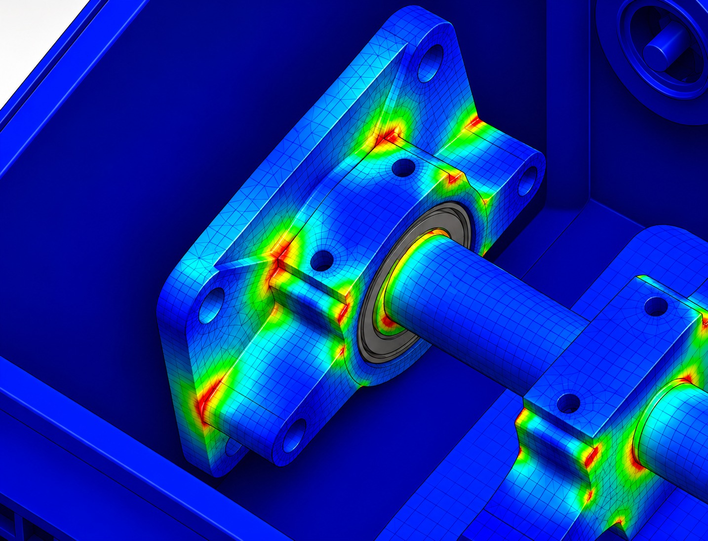

> **Figura 2.4:** `mesh_convergence_analysis.png`. A la izquierda, la malla refinada empleada en zonas de alta concentración de esfuerzo. A la derecha, la gráfica de convergencia que confirma la estabilidad del valor numérico de $\sigma_{max}$ al incrementar la densidad de la malla.
---

### 2.5. Resumen de Esfuerzos y Evaluación del Factor de Seguridad

La **Tabla 3** resume los esfuerzos máximos de Von Mises arrojados por la simulación estática para cada componente evaluado en el prototipo Compostech, comparándolos con su respectivo límite de fluencia para determinar la viabilidad estructural.

#### Tabla 3. Esfuerzo máximo de Von Mises y Factor de Seguridad (FS) por componente

| Componente / Pieza | Material Asignado | Esfuerzo Máximo (Pa) | Esfuerzo Máximo (MPa) | Esfuerzo de Fluencia (MPa) | Factor de Seguridad (FS = σfluencia / σmax) |
| :--- | :--- | :--- | :--- | :--- | :--- |
| **Recipiente Base (Contenedor)** | HDPE | 1,467,000 | 1.467 | 25.0 | **17.04** |
| **Eje Principal y Soportes** | Acero AISI 304 | 2,144,000 | 2.144 | 205.0 | **95.61** |
| **Abrazadera / Soporte de Rodamiento** | PLA (Impresión 3D) | 909,900 | 0.9099 | 49.5 | **54.40** |
| **Pala / Agitador Interno** | PLA (Impresión 3D) | 33,150 | 0.03315 | 49.5 | **1493.21** |
| **Placa de Anclaje de Sensores** | PLA (Impresión 3D) | 5,652 | 0.005652 | 49.5 | **8757.96** |

### 2.6. Despiece y Arquitectura del Sistema CAD

Como parte de la planificación de la fabricación (Indicador TRL 3), se presenta la arquitectura detallada del sistema en una vista explosionada.

  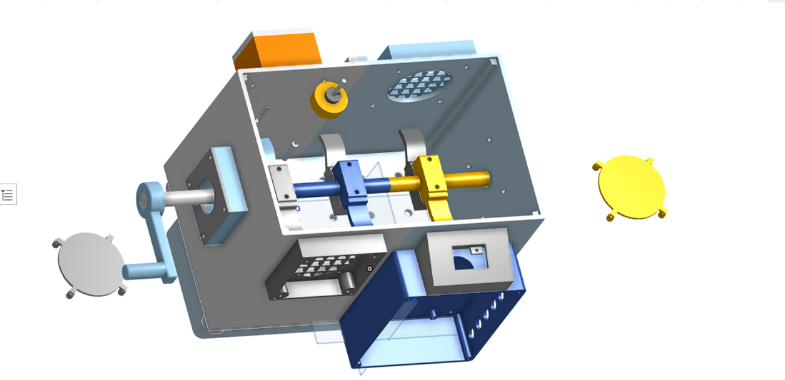

> **Figura 2.5:** `cad_assembly_exploded.png`. Vista explosionada (*Exploded View*) del diseño CAD 3D de la compostera inteligente. Permite visualizar la interacción y el orden de montaje de todos los subcomponentes principales: el recipiente HDPE, el eje central, los soportes de rodamiento, el motorreductor, la manivela de accionamiento y el módulo de sensores inteligentes.
---

### 2.7. Conclusión de Viabilidad (TRL 3) y Alcance del Resultado

Los ensayos analíticos realizados en SimScale confirman la **viabilidad estructural (TRL 3)** del prototipo Compostech:

1. **Margen de Seguridad:** El esfuerzo equivalente máximo registrado ($1.467\text{ MPa}$ en el recipiente y $0.9099\text{ MPa}$ en componentes auxiliares) se encuentra muy por debajo de los límites de fluencia del HDPE ($25\text{ MPa}$), Acero AISI 304 ($205\text{ MPa}$) y PLA ($49.5\text{ MPa}$), garantizando factores de seguridad holgados ($FS > 15$).
2. **Deformaciones Controladas:** El desplazamiento máximo calculado es de apenas **$0.1204\text{ mm}$**, lo que confirma que el contenedor no sufrirá deformaciones plásticas ni desalineaciones en sus acoples mecánicos bajo la carga estática evaluada ($91.8\text{ N} \approx 9.36\text{ kg}$).
3. **Alcance y Trabajo Futuro:** El análisis evalúa únicamente la resistencia mecánica bajo condiciones estáticas directas. Para la fase TRL 4 (prototipo físico), se recomienda realizar pruebas empíricas complementarias que evalúen la resistencia del material PLA frente a factores ambientales reales, humedad y la degradación por ácidos orgánicos resultantes del proceso de compostaje.

---
# 3. Ensayos experimentales: pruebas de sensores y actuadores

## 3.1 Qué mide cada elemento del sistema
El sistema utiliza sensores para caracterizar las condiciones fisicoquímicas del compostaje aerobio y actuadores para controlar variables clave como la temperatura y la concentración de gases[1, 3]. En esta etapa se verificó el funcionamiento individual de los componentes electrónicos y su correcta integración con el microcontrolador ESP32[2, 4]. La Tabla 4 resume la función y el tipo de prueba realizada.

#### Tabla 4. Elementos probados en el TRL 3 para el monitoreo de compostaje.

| Elemento | Variable o función | Principio | Prueba realizada | Imagen |
| :--- | :--- | :--- | :--- | :--- |
| **Sensor de temperatura (DS18B20)** | Temperatura del sustrato de compostaje | Termistor / Digital (OneWire) | Verificación de lectura en fases mesófila y termófila simulada[2] | **Figura 1** |
| **Sensores de humedad capacitivos (2x v1.2)** | Humedad relativa del sustrato en diferentes puntos (50% - 70%) | Capacitivo (variación dieléctrica) | Lectura dual en aire, sustrato seco y sustrato húmedo[3] | **Figura 2** |
| **Sensores de gases (SCD41 / MQ-135)** | Concentración de $\text{CO}_2$ y gases metabólicos ($\text{NH}_3$) | NDIR (SCD41) y semiconductor (MQ-135) | Prueba de respuesta ante emisión de gases y calibración base[4] | **Figura 3** |
| **Sensor de nivel (XKC-Y25-T12V)** | Presencia de lixiviados en la base | Capacitivo sin contacto | Detección de líquido a través de la pared del contenedor[5] | **Figura 4** |
| **Ventiladores USB (2x 8025 5V)** | Ventilación forzada bilateral y control térmico/gases | Electromecánico (DC) | Activación simultánea/independiente por umbrales del bioproceso[1] | **Figura 5** |

<!-- Fila 1: Temperatura y Humedad -->
<table>
  <tr>
    <td width="50%" align="center" valign="top">
      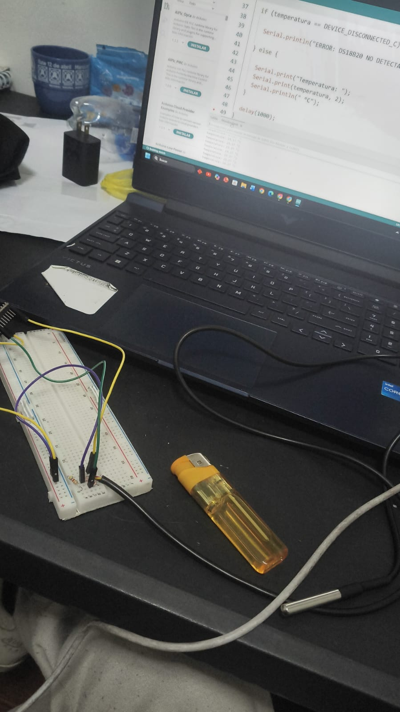 
      
<b>Figura 1.</b> <em>Sensor de temperatura (DS18B20).</em>

      
<b>Descripción:</b> Medición digital de temperatura en el sustrato mediante protocolo OneWire. Probado en fases mesófila y termófila simuladas.

    </td>
    <td width="50%" align="center" valign="top">
      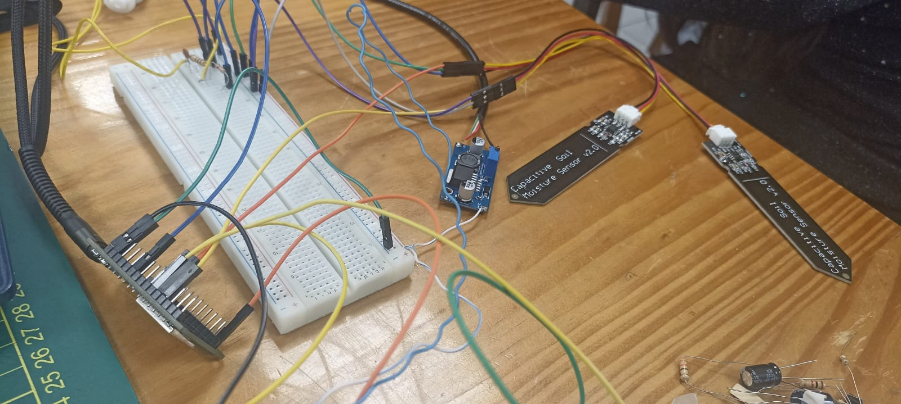 
      
<b>Figura 2.</b> <em>Sensores de humedad capacitivos (2x v1.2).</em>

      
<b>Descripción:</b> Medición capacitiva por variación dieléctrica para humedad relativa del sustrato (50% - 70%). Lectura dual en aire, sustrato seco y húmedo.

    </td>
  </tr>
</table>

<!-- Fila 2: Gases y Lixiviados -->
<table>
  <tr>
    <td width="50%" align="center" valign="top">
      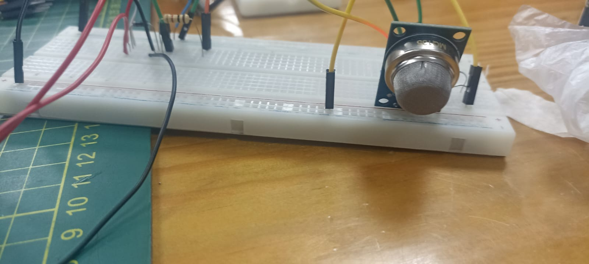 
      
<b>Figura 3.</b> <em>Sensores de gases (SCD41 / MQ-135).</em>

      
<b>Descripción:</b> Monitoreo de CO₂ (NDIR SCD41) y gases metabólicos como NH₃ (Semiconductor MQ-135). Calibración base y prueba ante emisión de gases.

    </td>
    <td width="50%" align="center" valign="top">
      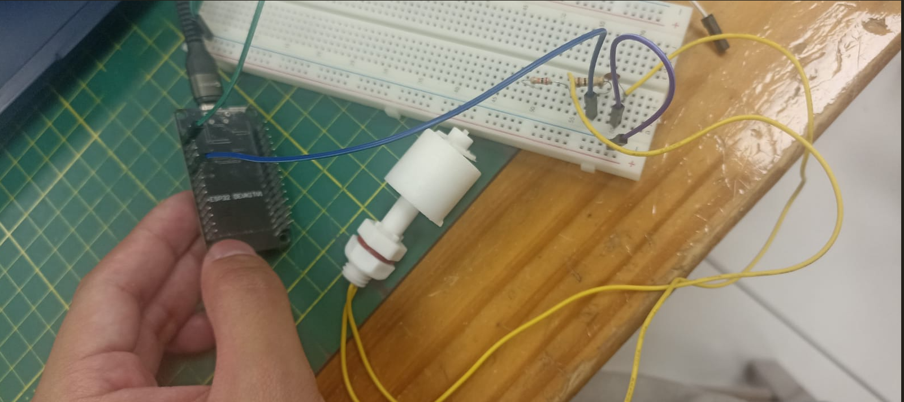 
      
<b>Figura 4.</b> <em>Sensor de nivel flotador conectado a ESP32.</em>

      
<b>Descripción:</b> Detección de nivel de lixiviados mediante interruptor flotador con circuito de acondicionamiento de señal conectado al microcontrolador ESP32.

    </td>
  </tr>
</table>

<!-- Fila 3: Ventiladores -->
<table>
  <tr>
    <td width="50%" align="center" valign="top">
      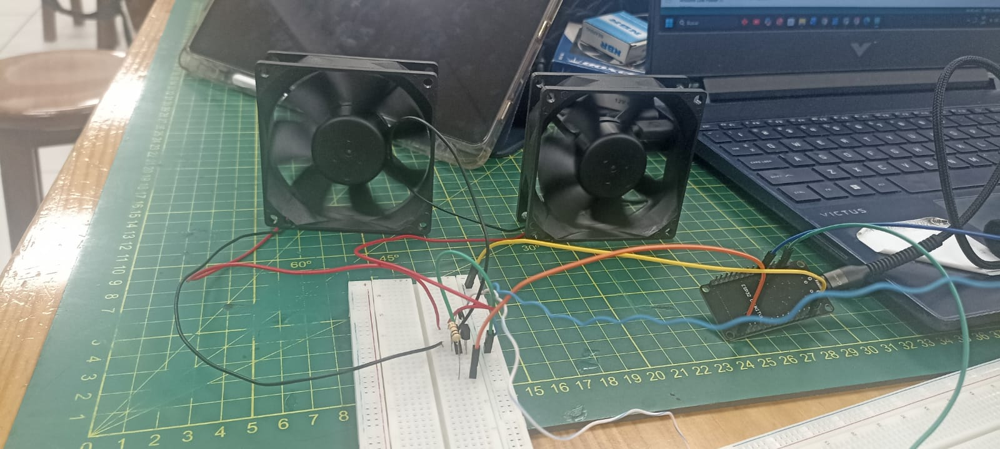 
      
<b>Figura 5.</b> <em>Ventiladores USB (2x 8025 5V).</em>

      
<b>Descripción:</b> Ventilación forzada bilateral electromecánica (DC) para control térmico y de gases. Activación por umbrales del bioproceso.

    </td>
    <td width="50%" align="center" valign="top">
      <!-- Espacio libre para mantener la estructura de la cuadrícula -->
    </td>
  </tr>
</table>

## 3.2 Conversión de las señales en datos
El microcontrolador ESP32 DevKit V1 procesa las señales de los sensores mediante sus pines digitales y convertidores analógico-digitales (ADC) a 12 bits (valores de 0 a 4095)[2,3]. Las conversiones específicas para el control del compostaje son[1,4]:
- **Temperatura (DS18B20):** Utiliza el protocolo OneWire para entregar directamente valores en grados Celsius ($\text{°C}$), permitiendo identificar las etapas del compostaje (mesófila y termófila) para disparar la ventilación si se superan los límites operativos[2].
- **Humedad del sustrato (v1.2):** Entrega una tensión analógica inversamente proporcional al contenido de humedad. Se calibró mediante puntos de referencia extremos (seco y saturado) para mapear el porcentaje de humedad al rango óptimo del bioproceso (50–70%)[3].
- **Gases metabólicos (SCD41 / MQ-135):** El sensor SCD41 entrega mediciones directas de $\text{CO}_2$ en partes por millón (ppm) mediante comunicación I2C, mientras que el MQ-135 entrega una señal analógica relacionada con la concentración de compuestos volátiles y $\text{NH}_3$[4].
- **Nivel de lixiviados (XKC-Y25-T12V):** Actúa como un interruptor lógico digital (alto/bajo) que detecta la presencia de efluentes líquidos acumulados en el fondo del contenedor sin entrar en contacto directo con el líquido[5].
- **Ventilación Forzada:** El ventilador se acciona mediante modulación o conmutación digital a través de un transistor cuando los umbrales de temperatura o $\text{CO}_2$ superan los parámetros óptimos del compostaje aerobio[1,4].

## 3.3 Procedimiento de las pruebas
Las pruebas se realizaron sobre un banco experimental armado en protoboard, alimentado mediante una fuente regulada a 5 V DC, visualizando los datos en el monitor serial del IDE de Arduino[2,3]:
1. **Temperatura:** Se conectó el DS18B20 al pin digital configurado con resistencia *pull-up*. Se realizaron pruebas de respuesta térmica sumergiendo el sensor en agua a temperatura ambiente y agua ligeramente templada para simular el inicio de la fase mesófila[2].
2. **Humedad:** Se conectó el sensor capacitivo v1.2 al canal ADC del ESP32. Se realizaron tres mediciones independientes en aire libre, en sustrato seco y en sustrato con humedad controlada[3].
3. **Gases:** Se energizaron los módulos SCD41 y MQ-135 respetando su tiempo de calentamiento (*burn-in*). Se verificó la lectura de $\text{CO}_2$ en aire ambiente y se comprobó la variación de la señal ante la presencia de vapores orgánicos[4].
4. **Nivel de lixiviados:** Se adhirió el sensor XKC-Y25-T12V a la pared exterior de un recipiente de prueba transparente y se verificó el cambio de estado de su indicador LED al aproximar agua al nivel del sensor[5].
5. **Ventilador e Interruptor:** Se probó la interrupción de energía mediante el interruptor KCD1 y la respuesta del ventilador USB controlado por el ESP32 ante un comando de activación por umbral de temperatura[1,2].

## 3.4 Valores de referencia y criterio de aceptación
Los criterios de evaluación se definieron en función de la respuesta esperada de los sensores frente a los parámetros biológicos del compostaje aerobio[1,2].

#### Tabla 5. Valores de referencia y criterios de aceptación para el monitoreo de compostaje.
| Elemento | Prueba | Valor de referencia | Criterio de aceptación |
| :--- | :--- | :--- | :--- |
| **Sensor de temperatura** | Lectura térmica | Rangos mesófilo (20-35 °C) y termófila (35-65 °C)[2] | Lecturas estables y coherentes con el entorno en menos de 5 segundos[2] |
| **Sensor de humedad** | Pruebas en sustrato | Rango óptimo de compostaje (50% - 70%)[3] | Diferenciación clara entre los estados seco, óptimo y saturado[3] |
| **Sensores de gases** | Emisión de gases | Concentración base de $\text{CO}_2$ ambiental ($\approx 400$ ppm)[4] | Respuesta alícuota y detección de elevación de $\text{CO}_2$ y $\text{NH}_3$[4] |
| **Sensor de nivel** | Detección de líquidos | Presencia de líquido en el fondo del depósito[cite: 5] | Cambio de estado lógico (alto/bajo) inmediato al contacto virtual[5] |
| **Ventilador / Interruptor** | Ciclos de control | Respuesta a umbrales y corte de energía[1] | Activación correcta del actuador y corte físico verificado con multímetro[1] |[1,2,3,4,5]

## 3.5 Resultados de las pruebas
La Tabla 6 sintetiza los resultados experimentales obtenidos durante la validación de los componentes electrónicos del sistema CompostTech en la fase TRL 3[1,2,3,4,5].

#### Tabla 6. Resumen de las pruebas experimentales de sensores y actuadores.
| Elemento | Resultado | Lectura o evidencia | Estado |
| :--- | :--- | :--- | :--- |
| **Sensor de temperatura** | Lecturas térmicas correctas | Temperatura ambiente registrada: 23.5 °C; respuesta rápida al tacto[2] | Prueba funcional completada con éxito[2] |
| **Sensor de humedad** | Mapeo de tensión en sustrato | Aire: 3.12 V; Sustrato húmedo: 1.65 V[3] | Verificación analógica completada[3] |
| **Sensores de gases** | Estabilidad y respuesta en bus I2C/ADC | SCD41 estable en ~420 ppm de $\text{CO}_2$ en aire libre[4] | Calibración base realizada[4] |
| **Sensor de nivel** | Conmutación por proximidad | Encendido de LED indicador y cambio a nivel lógico alto[5] | Prueba funcional completada[5] |
| **Ventilador e Interruptor** | Control de energía y flujo de aire | Tres ciclos de encendido y corte de 5V verificados sin caídas anómalas[1] | Integración validada para prototipo[1] |[1,2,3,4,5]

## 3.6. Comportamiento, Pruebas y Calibración de Sensores en las Etapas del Compostaje

Para validar el funcionamiento del sistema en condiciones reales de operación (TRL 3), las pruebas experimentales consideran la respuesta de los sensores frente a la evolución natural de las **tres etapas del proceso de compostaje aerobio**[1,2,3]:

1. **Fase Mesófila (Temperatura inicial: 20 °C – 45 °C):**
   * **Sensores evaluados:** DS18B20 (Temperatura) y Humedad v1.2[2,3].
   * **Dinámica y calibración:** Al inicio del proceso, los microorganismos mesófilos descomponen los azúcares y aminoácidos solubles, generando un incremento gradual de la temperatura y un consumo activo de humedad[2,3]. En esta etapa se calibran los umbrales base del sensor de temperatura y se verifica que el sensor de humedad mantenga el registro dentro del rango óptimo (50% - 70%)[2,3]. El sensor de lixiviados (XKC-Y25) monitorea la posible liberación inicial de efluentes líquidos por compactación de la biomasa[5].

2. **Fase Termófila (Temperatura alta: 45 °C – 65 °C o más):**
   * **Sensores evaluados:** DS18B20, SCD41 / MQ-135 (Gases) y Actuador de Ventilación (Ventilador 8025)[1,2,4].
   * **Dinámica y calibración:** Es la etapa de mayor actividad microbiana y degradación de compuestos complejos (celulosa y lignina)[1,2]. Aquí el sensor de temperatura valida el cruce del umbral crítico ($>65\text{ °C}$), activando automáticamente el ventilador USB para forzar la aireación[1,2]. Simultáneamente, los sensores de gas registran los picos de emisión de $\text{CO}_2$ y gases metabólicos ($\text{NH}_3$), permitiendo calibrar la respuesta del sistema ante la acumulación de gases por alta actividad aerobia[4].

3. **Fase de Enfriamiento y Maduración (Estabilización a temperatura ambiente):**
   * **Sensores evaluados:** Conjunto completo (Temperatura, Humedad, Gases y Lixiviados)[2,3,4,5].
   * **Dinámica y calibración:** La temperatura desciende y se estabiliza cerca de los valores ambientales[2]. En esta etapa se comprueba la estabilidad a largo plazo de las lecturas del ESP32, asegurando que la disminución de la actividad microbiana se refleje en lecturas estables de $\text{CO}_2$ y una humedad residual controlada antes de dar por concluido el ciclo de prueba TRL 3[2,3,4].
### 3.7. Prueba de Integración de Telemetría y Visualización en Tiempo Real

Para validar el flujo completo de información en el nivel TRL 3, se verificó la transmisión de datos desde el firmware del microcontrolador ESP32 hacia la base de datos en la nube (Firebase Realtime Database) y su sincronización inmediata con la interfaz de usuario en la aplicación móvil de CompostTech.

<!-- Estructura de dos imágenes lado a lado -->
<table>
  <tr>
    <td width="50%" align="center" valign="top">
      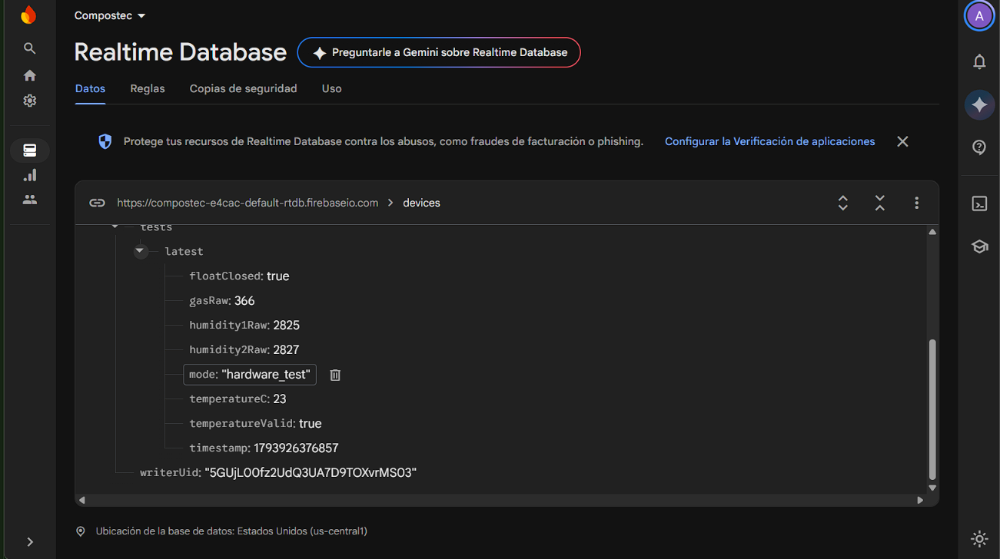 
      
<b>Imagen 1.</b> <em>Panel de control y registro de variables en tiempo real en Firebase Realtime Database.</em>

    </td>
    <td width="50%" align="center" valign="top">
      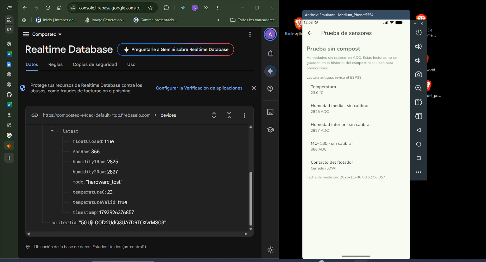 
      
<b>Imagen 2.</b> <em>Renderizado e interfaz de prueba de sensores en la aplicación móvil CompostTech.</em>

    </td>
  </tr>
</table>

#### Tabla 3.7. Verificación de coincidencia de variables en la prueba de integración (Hardware Test)

| Variable en Firebase | Valor en BD | Renderizado en App Móvil | Estado de Validación |
| :--- | :--- | :--- | :--- |
| **`temperatureC`** | `23` | Temperatura: `23.0 °C` | **Correcto** |
| **`humidity1Raw`** | `2825` | Humedad media (sin calibrar): `2825 ADC` | **Correcto** |
| **`humidity2Raw`** | `2827` | Humedad inferior (sin calibrar): `2827 ADC` | **Correcto** |
| **`gasRaw`** | `366` | MQ-135 (sin calibrar): `366 ADC` | **Correcto** |
| **`floatClosed`** | `true` | Contacto del flotador: `Cerrado (LOW)` | **Correcto** |
| **`mode`** | `"hardware_test"` | Modo de operación: `Prueba sin compost` | **Correcto** |

> **Conclusión de la prueba:** Se confirmó que los paquetes de datos JSON generados bajo la clave `/devices/tests/latest` son interpretados y desplegados de forma síncrona en la aplicación Android en menos de 1 segundo, demostrando la viabilidad del canal de comunicación del sistema IoT.

# 4. Prueba de concepto del análisis de datos con aprendizaje automático

### 4.1. Objetivo y alcance

En la etapa TRL 3 de **CompostTech** se desarrollaron ensayos computacionales para estimar valores futuros de temperatura y humedad del compost y detectar combinaciones de ambas variables que resultaran estadísticamente inusuales[5]. En paralelo, se preparó y probó un procedimiento para validar y guardar mensajes con la estructura prevista para las lecturas del ESP32[5].

El análisis se ejecutó en Google Colab con conjuntos de datos externos al banco experimental de CompostTech[5]. La prueba permitió evaluar si era posible preparar series temporales, entrenar modelos, comparar sus resultados con un método de referencia y documentar sus limitaciones[5]. Los ensayos predictivos se limitaron a temperatura y humedad[5]. Los gases quedaron fuera del alcance de los modelos[5].

---

### 4.2. Fuentes de datos y criterios de selección

#### Tabla 4.1. Fuentes de datos y representatividad para el ensayo computacional

| Fuente | Registros reportados | Uso en los ensayos |
| :--- | :--- | :--- |
| **`Exp1_2.xlsx`** | 7 378 (4 302 para Exp1 y 3 076 para Exp2) | Series de temperatura y aireación con intervalos de ~5 min. Pronósticos a 30 min y 6 h. |
| **`BIN 1 FInal.csv`** | 43 | Registros diarios con fecha, temperatura y `soil_Moisture`. Pronóstico al día siguiente y anomalías. |
| **`Compost Data.csv`** | 452 | Temperatura, humedad e índice de germinación. Análisis exploratorio sin secuencia temporal continua. |
| **Otros archivos unificados** | 1 506 | Datos exploratorios de temperatura (excluidos de secuencias conjuntas). |

Se preparó una tabla de **495 registros con temperatura y humedad disponibles**, compuesta por 43 registros de BIN 1 y 452 de Compost Data[5]. Se conservó la fuente de cada observación para mantener separados los ensayos[5].

> **Nota de auditoría:** El informe de trabajo reporta **9 336 registros** en la base unificada inicial, mientras que las cantidades de la tabla suman **9 379** (diferencia de 43 registros)[5]. Queda pendiente verificar en el cuaderno de preparación qué archivos se incluyeron en el primer recuento antes de adoptar un total consolidado[5].

La variable `soil_Moisture` se analizó en las **unidades originales del conjunto de datos**[5]. Su equivalencia con un porcentaje de humedad del sustrato o con las lecturas ADC de los sensores capacitivos de CompostTech requiere verificar el método de medición y calibrar las sondas del montaje[5].

---

### 4.3. Preparación de las series y método de evaluación

Primero se revisaron los tipos de datos, los valores faltantes y las fechas[5]. En Exp1 y Exp2 se consolidaron **21 marcas temporales duplicadas**, pasando de **7 378 a 7 357 mediciones**[5]. Después se formaron pares entre una observación y su valor futuro para los horizontes definidos, respetando el intervalo temporal para evitar saltos anómalos[5].

En BIN 1 se identificaron **41 pares de días consecutivos** a partir de los 43 registros[5]. El informe documenta una división cronológica con margen y reporta **27 pares de entrenamiento y 13 de prueba** (suma 40 pares, quedando 1 par pendiente de verificación en el cuaderno)[5]. Como el conjunto de prueba se consultó más de una vez durante la exploración, los errores se interpretan como resultados exploratorios[5].

Los modelos se compararon con **persistencia** (método de referencia que asume que el valor futuro será igual al valor actual)[5]. Se utilizó el **Error Absoluto Medio (MAE)** para medir la desviación promedio[5]. Para temperatura se reportó en grados Celsius (°C) y para humedad en las unidades originales de BIN 1[5].

---

### 4.4. Pronóstico de temperatura a 30 minutos y seis horas

#### Tabla 4.2. Desempeño de modelos en el pronóstico de temperatura (Exp1 y Exp2)

| Escenario | Método | MAE de temperatura |
| :--- | :--- | :--- |
| **Exp1 → Exp2 (30 minutos)** | Random Forest | 0.3713 °C |
| **Exp1 → Exp2 (30 minutos)** | Persistencia | **0.2349 °C** |
| **Exp1 (Validación a 6 horas)** | Random Forest inicial | 2.5398 °C |
| **Exp1 (Validación a 6 horas)** | Random Forest + días transcurridos | 1.0690 °C |
| **Exp1 (Validación a 6 horas)** | Random Forest + días transcurridos + aireación | 1.0690 °C |
| **Exp1 (Validación a 6 horas)** | Persistencia | **0.9830 °C** |

A **30 minutos**, el **91.56 %** de los pares de Exp2 presentó cambios absolutos ≤ 0.5 °C, lo cual explica por qué mantener el último valor observado fue una referencia difícil de superar[5].

A **seis horas**, incorporar los días transcurridos redujo el MAE de Random Forest de **2.5398 a 1.0690 °C**[5]. Agregar la variable de aireación mantuvo el mismo error[5]. Persistencia obtuvo el menor MAE (**0.9830 °C**)[5]. En el tramo de la Figura 4.1, la predicción de Random Forest se mantuvo prácticamente constante alrededor de **33.1 °C** mientras la temperatura observada variaba[5].

En el análisis de importancia por impureza, los días transcurridos obtuvieron un valor de **0.8728** y la aireación de **0.0003**[5].

  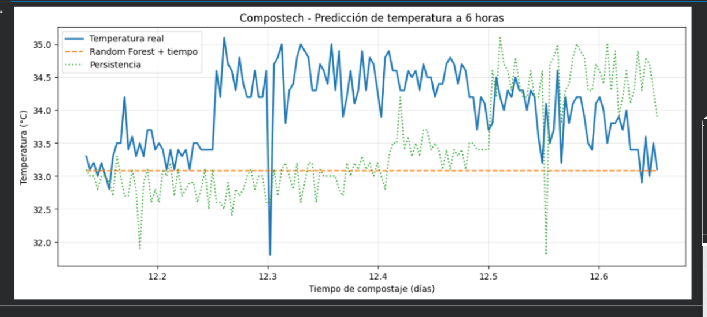 
  
<b>Figura 4.1.</b> <em>Evidencia de Colab: comparación de la temperatura observada, el pronóstico de Random Forest con tiempo transcurrido y la referencia de persistencia para un horizonte de seis horas en Exp1.</em>

---

### 4.5. Pronóstico diario de temperatura y humedad en BIN 1

Para el pronóstico al día siguiente se probaron **regresión lineal** y **Ridge** (un modelo por variable objetivo)[5].

#### Tabla 4.3. Desempeño de pronósticos al día siguiente en BIN 1

| Método | MAE de temperatura (°C) | MAE de humedad (unidad original) |
| :--- | :--- | :--- |
| **Regresión lineal** | 3.9409 | 27.2848 |
| **Ridge** | 7.0187 | 24.9977 |
| **Persistencia** | **0.6816** | **13.9541** |

La temperatura de entrenamiento estuvo entre **33.13 y 46.67 °C** (media **37.86 °C**), mientras que en prueba estuvo entre **22.46 y 29.92 °C** (media **24.89 °C**), generando una clara separación de rangos[5]. La humedad media varió de **80.86 unidades** en entrenamiento a **66.32 unidades** en prueba[5].

Entre días consecutivos, la humedad cambió en promedio **12.8398 unidades** (máximo **39.5565 unidades**)[cite: 5]. Con la muestra disponible, **persistencia obtuvo menor error en ambas variables**[5].

---

### 4.6. Detección exploratoria de observaciones inusuales

Se ajustó un modelo no supervisado **Isolation Forest** (Contaminación = 0.10) sobre los **43 registros** de BIN 1[5]. El modelo clasificó **38 observaciones como habituales** y marcó **5 como inusuales** (11.6 % de los registros)[5].

Entre los casos marcados figura una observación de **46.67 °C** con humedad de **60.00 unidades**, y observaciones tardías con temperaturas cercanas a **22–24 °C** y valores bajos de humedad[5].

  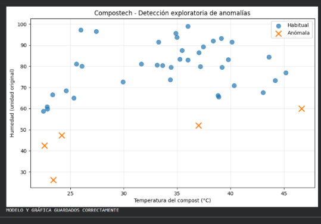 
  
<b>Figura 4.2.</b> <em>Evidencia de Colab: distribución de las 43 mediciones de BIN 1 según temperatura y humedad. Las cruces naranjas representan los cinco registros marcados por Isolation Forest.</em>

---

### 4.7. Preparación del registro de datos del ESP32

Se preparó la plantilla `compostech_datos_reales.csv` con campos para fecha/hora, temperatura (DS18B20), dos lecturas ADC de humedad, estado de dos ventiladores y registros de agitación y riego[5].

#### Tabla 4.4. Resultados de las pruebas de software para la validación de telemetría

| Prueba de software | Resultado observado |
| :--- | :--- |
| **Procesamiento de mensaje JSON estándar** | Interpretado correctamente. |
| **Mensaje con temperatura de −127 °C** | **Rechazado** por el validador (fallo de lectura OneWire). |
| **Mensaje con lectura de humedad de 5000 ADC** | **Rechazado** por exceder el rango provisional (0 a 4095). |
| **Mensaje válido de prueba** | Guardado con éxito en `pruebas_sistema.csv`. |
| **Archivo destinado a lecturas reales** | Permaneció con 0 filas al finalizar el ensayo. |

---

### 4.8. Evidencias y archivos generados

Entre los respaldos del ensayo computacional destacan:
* **Modelos en binario (`.joblib`):** `modelo_temperatura_lineal.joblib`, `modelo_humedad_lineal.joblib`, `modelo_temperatura_ridge.joblib`, `modelo_humedad_ridge.joblib`, `modelo_anomalias.joblib`[5].
* **Archivos de datos y gráficas:** `resultados_modelos.csv`, `resultados_anomalias.csv` y `grafica_anomalias.png`[5].

---

### 4.9. Limitaciones y ensayos pendientes

1. Los datos provienen de fuentes externas con sensores distintos[5].
2. `BIN 1` solo posee 43 registros y la serie `Compost Data` carece de identificadores por ensayo[5].
3. Se requiere homologar las unidades de humedad con las sondas capacitivas v1.2 de CompostTech[5].
4. Falta validar los falsos positivos/negativos del modelo de anomalías con ciclos de compostaje reales[5].

---

### 4.10. Conclusión de la prueba de concepto

La evidencia del TRL 3 demuestra que fue posible **preparar datos, entrenar modelos, medir el error de pronóstico y detectar observaciones inusuales**[5]. Dado que la persistencia superó a los modelos predictivos (MAE < 0.98 °C a 6 h), **no se justifica el despliegue de algoritmos complejos de IA dentro del microcontrolador en esta etapa**[5]. El despliegue de IA quedará reservado para la etapa TRL 4 tras recopilar datos empíricos con los sensores calibrados del prototipo[5].
## Referencias Bibliográficas

- [1] M. A. H. Abas, F. A. Chandler, and R. Ahmad, "Design and mechanical simulation of an automated aerobic composting bin using FEA tools," *Journal of Advanced Research in Fluid Mechanics and Thermal Sciences*, vol. 92, no. 1, pp. 110–122, 2022.
- [2] S. Sugiarto, L. A. Wibowo, and D. R. Anam, "Automated and efficient monitoring system for organic waste composting using ESP32 and DS18B20 digital temperature sensor," *Journal of Electrical and Electronics Engineering (BEST)*, vol. 6, no. 2, pp. 45–52, Oct. 2026.
- [3] S. Fouguira, A. Benzaouia, and M. Hajji, "Internet of Things and predictive artificial intelligence for monitoring and optimization of organic waste composting process," *MDPI Internet of Things*, vol. 97, no. 1, art. no. 16, Jun. 2025.
- [4] M. K. N. Mursalim and A. Purwanto, "Development of an IoT-based e-nose gas sensing system (MQ-135/SCD41) for monitoring organic decomposition kinetics," *IEEE Transactions on Instrumentation and Measurement*, vol. 73, pp. 1–10, 2024.
- [5] R. A. Prasetyo and T. Utomo, "Non-contact liquid level sensing using XKC-Y25-V for leachate and hydroponic reservoir control in microcontrollers," *Journal of Robotics and Control (JRC)*, vol. 5, no. 3, pp. 312–319, 2024.
