# VALIDACIÓN TECNOLÓGICA EN ENTORNO DE LABORATORIO – PRUEBAS DE BAJA FIDELIDAD — TRL 4

## Validación de componentes y prototipo funcional en entorno de laboratorio

> **Proyecto:** CompostTech (Monitor de Compostaje Doméstico Inteligente — Biorreactor doméstico compacto para compostaje aeróbico con sistema de mezclado manual seguro, monitoreo multisensorial IoT y toma de decisiones mediante inteligencia artificial).

| Campo | Información |
| :--- | :--- |
| **Curso** | Proyecto Integrador 2026-II |
| **Integrantes** | Jhunior Moieses Aliaga Cueva; Leonela Angela Aldana Porras; Juan Carlo Ancco Quispe; Alex Jhosep Ccoyllo Sotelo; Ruth Carina Turpo Cayo |
| **Ingenieros** | Umbert Lewis De La Cruz, María Rejas, Harry Rivera y Renzo Chan |
| **Fecha de actualización** | 24/11/2026 |
| **Institución** | Universidad Peruana Cayetano Heredia |
| **Tema** | TRL 4 de Monitor de Compostaje Doméstico Inteligente (CompostTech) |

---

## 1. Objetivo de la validación tecnológica

Validar a nivel de laboratorio y en un ambiente simulado de uso doméstico el funcionamiento integrado del prototipo funcional **«Compostech»** (biorreactor compacto para compostaje aeróbico asistido por IoT e Inteligencia Artificial). 

El propósito específico de esta etapa **TRL 4** es comprobar que los subsistemas mecánico, electrónico, de sensado y de software operan de manera conjunta y sincronizada sin interferencias físicas ni degradación de componentes, demostrando la capacidad del sistema para:
* Monitorear variables críticas en tiempo real (temperatura central, humedad estratificada, gases volátiles $CO_2$ / $NH_3$ y nivel de lixiviados).
* Ejecutar el control térmico y de aireación automatizado mediante histéresis.
* Clasificar las etapas del proceso mediante un modelo predictivo (*Random Forest*) para emitir alertas preventivas en una aplicación móvil.

---

## 2. Diseño del prototipo

El diseño del prototipo **«Compostech»** responde a una arquitectura modular compacta orientada a superar las limitaciones de las composteras pasivas (falta de control y malos olores) y de los compostadores eléctricos comerciales (alto consumo energético por resistencias y trituración).

* **Estructura y cámara de compostaje:** Cuerpo principal fabricado en ácido poliláctico (PLA) mediante impresión 3D (con proyección industrial a polipropileno copolímero, PP), conformado por dos mitades de `180 × 280 × 200 mm` unidas mediante bridas, pernos M3 y refuerzos de varillas de `14.74 MPa`. Incluye una tapa superior de `280 × 180 mm` y un fondo ranurado para drenaje gravitacional.
* **Sistema de aireación mecánica con zona de guarda:** Eje segmentado de `16 mm` acoplado a una manivela externa de `150-180 mm` de brazo y soportado por rodamientos sellados (`6003-2RS`), retenes y collarines. El eje incorpora paletas curvas mezcladoras dispuestas dejando un espacio central libre (*zona de guarda*), diseñado específicamente para evitar el choque mecánico y el cizallamiento de las sondas internas durante el volteo.
* **Protección contra condensación y gestión de lixiviados:** Carcasa lateral con ranuras inclinadas para alojar el sensor de gases, evitando el contacto directo con condensación ácida; bandeja inferior extraíble de `1,4 L` (`200 × 100 × 70 mm`) para recolección de lixiviados; soporte inclinado ergonómico para visualización local y caja electrónica estanca (`130 × 150 × 50 mm`).

---

## 3. Integración de componentes

En esta fase se consolidó la integración física, eléctrica y lógica de los cuatro subsistemas básicos del prototipo para garantizar su operación conjunta:

| Subsistema | Componentes Integrados | Interfaz y Función de Integración |
| :--- | :--- | :--- |
| **Mecánico y Estructural** | Cámara en PLA, eje segmentado (`15-16 mm`), paletas curvas, manivela (`150-180 mm`), rodamientos `6003-2RS` y bandeja inferior. | Permite el volteo manual (5–10 vueltas/ciclo) manteniendo la integridad física de las sondas internas gracias a la zona de guarda y drenando líquidos hacia la bandeja. |
| **Adquisición de Datos (Sensado)** | Sonda térmica `DS18B20` (núcleo), 2 sensores capacitivos de humedad `v1.2` (estrato superior e inferior), sensor de gases `MQ-135` (carcasa ranurada) y flotador magnético `P45` (bandeja). | Muestrean simultáneamente cada **4 segundos** las condiciones fisicoquímicas de la biomasa y el nivel de lixiviados sin exposición directa a condensación ni golpes mecánicos. |
| **Control y Actuación Local** | Microcontrolador `ESP32` en PCB FR-4, ventilador extractor de `12 V DC` y pantalla OLED I2C (`SSD1306`). | El ESP32 filtra las señales cada 4 s, ejecuta el lazo de control On-Off con histéresis térmica (encendido `≥ 58 °C` o pico de gases; apagado `< 55 °C`) para el extractor y actualiza métricas e íconos de estado en la pantalla OLED. |
| **Software e Inteligencia Artificial** | Firmware ESP32 (Wi-Fi), base de datos en `Firebase`, aplicación móvil en `Flutter` y modelo `Random Forest`. | Transmite los registros por Wi-Fi hacia la app, donde el algoritmo *Random Forest* clasifica el proceso en 4 estados (mesófila, termófila, enfriamiento o condición anómala/anaerobia) y dispara recomendaciones preventivas. |

---

## 4. Materiales y equipos

Para la fabricación del prototipo funcional y la ejecución de las pruebas de validación a nivel laboratorio se emplearon los siguientes recursos:

### Materiales de fabricación y electrónicos
* **Polímeros y sujeción:** Filamento PLA para impresión 3D de carcasa, soportes, paletas y bandeja; pernos y tuercas M3, varillas de refuerzo de `14.74 MPa`, eje de `15-16 mm`, rodamientos sellados `6003-2RS`, collarines y retenes de estanqueidad.
* **Electrónica y potencia:** Placa de circuito impreso (PCB FR-4), microcontrolador `ESP32`, sensor de temperatura sumergible `DS18B20` con vaina metálica, dos sensores capacitivos de humedad de suelo `v1.2`, sensor de calidad de aire/gases `MQ-135`, sensor de nivel tipo flotador magnético `P45`, pantalla OLED `SSD1306` (0.96" I2C), ventilador extractor axial de `12 V DC`, etapa de conmutación y fuente de alimentación regulada de `12 V / 5 V`.
* **Sustrato orgánico de prueba (ambiente simulado):** Residuos vegetales domésticos picados (cáscaras de frutas y verduras) mezclados con material estructurante seco rico en carbono (hojas secas, aserrín o cartón trozado) y agua para ajuste inicial de humedad.

### Equipos e instrumentos de laboratorio y software
* Impresora 3D FDM (manufactura de piezas estructurales y carcasas).
* Multímetro digital y fuente de alimentación DC de laboratorio (verificación de continuidad, voltajes y consumo del extractor de `12 V`).
* Termómetro e higrómetro patrón de referencia (contrastación de lecturas del `DS18B20` y sensores capacitivos).
* Balanza digital y probeta graduada (dosificación de sustrato húmedo/seco y verificación del volumen de lixiviados al `75 %` de los `1,4 L` de la bandeja).
* Computadora de desarrollo con entornos `Arduino IDE / PlatformIO`, `Flutter SDK`, consola de `Firebase` y entorno `Python` (entrenamiento y validación del modelo *Random Forest*).

---

## 5. Metodología y procedimiento experimental

La validación experimental de baja fidelidad se estructuró en cuatro fases secuenciales en entorno de laboratorio para verificar la trazabilidad de cada subsistema y su desempeño integrado:

1. **Verificación mecánico-estructural y de estanqueidad:**
   * Se ensambló la cámara principal, el eje segmentado con paletas curvas y la bandeja inferior.
   * Se cargó la cámara con una mezcla simulada de residuos orgánicos y material seco, ejecutando ciclos de volteo manual (`5 a 10 vueltas` con la manivela).
   * *Parámetro verificado:* Ausencia de colisión entre las paletas y las sondas ubicadas en la zona central de guarda, fluidez del torque manual en los rodamientos `6003-2RS` y drenaje efectivo hacia la bandeja sin fugas laterales.

2. **Calibración y trazabilidad de sensores en banco de pruebas:**
   * Se contrastaron las lecturas enviadas por el `ESP32` cada `4 segundos` frente a instrumentos patrón.
   * Se evaluó la respuesta de los sensores capacitivos `v1.2` en tres escenarios controlados de sustrato: condición seca (`< 45 %`), rango óptimo (`45 % – 70 %`) y saturación (`> 70 %`).
   * Se verificó la activación del flotador magnético `P45` llenando la bandeja de lixiviados hasta alcanzar el umbral del `75 %` de su capacidad total (`≈ 1,30 L` de `1,4 L`).

3. **Prueba del lazo de control térmico y extracción de gases (histéresis):**
   * Se sometió la sonda `DS18B20` a un incremento controlado de temperatura hasta alcanzar o superar los `58 °C`, y se expuso el sensor `MQ-135` (dentro de su carcasa con ranuras inclinadas) a vapores volátiles simulados.
   * *Parámetro verificado:* Encendido automático del extractor de `12 V DC` al cruzar el umbral superior (`≥ 58 °C` o pico de gas), mantenimiento de la extracción durante el descenso térmico y apagado automático estricto al descender por debajo de `55 °C`, corroborando además que la carcasa lateral impidiera la acumulación de condensación sobre el `MQ-135`.

4. **Prueba de integración IoT, visualización OLED y clasificación por IA:**
   * Se conectó el prototipo a una red Wi-Fi local y se registraron series temporales de datos en `Firebase` y en la interfaz móvil en `Flutter`.
   * Se inyectaron perfiles de datos correspondientes a las cuatro condiciones operativas (**fase mesófila**, **termófila `≥ 55 °C`**, **enfriamiento** y **condición anaerobia**) para verificar la actualización sincronizada entre la pantalla OLED local, la clasificación del modelo *Random Forest* y el despliegue de alertas preventivas en la app (volteo, riego, adición de material seco o vaciado de bandeja).

---
# 6. PRUEBAS DE FUNCIONAMIENTO

Para la validación tecnológica del TRL 4 de COMPOSTECH, se realizaron pruebas en condiciones controladas para verificar el funcionamiento de los sensores, el sistema de ventilación y la comunicación entre los componentes electrónicos.

### A. Prueba de funcionamiento de los sensores de humedad

**Procedimiento:** Se conectaron dos sensores capacitivos al controlador ESP32 para monitorear la humedad en la zona media e inferior del compostador. Mediante Arduino IDE se verificó el registro de las lecturas y la respuesta de los sensores ante diferentes condiciones de humedad.

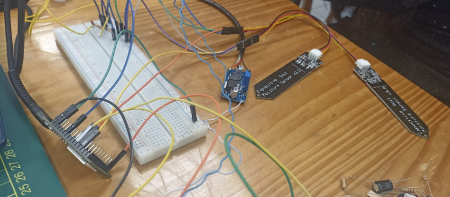
> **Figura 1.** Montaje de los sensores de humedad de COMPOSTECH.  
> *Nota. Registro fotográfico propio del equipo COMPOSTECH.*

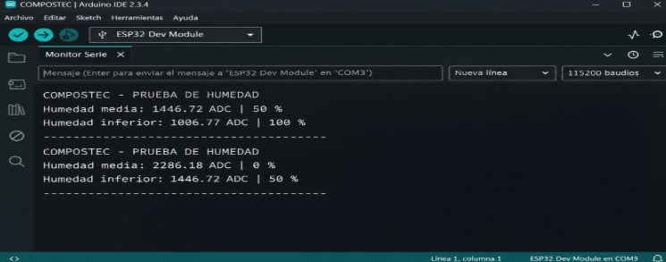)
> **Figura 2.** Comprobación y funcionamiento del registro de humedad mediante el monitor serial de Arduino IDE.  
> *Nota. Registro propio de los resultados de Arduino IDE.*

**Justificación de funcionamiento:**  
Para evaluar la respuesta de los sensores, se consideraron tres condiciones de humedad del compost, estableciendo los siguientes valores de referencia.

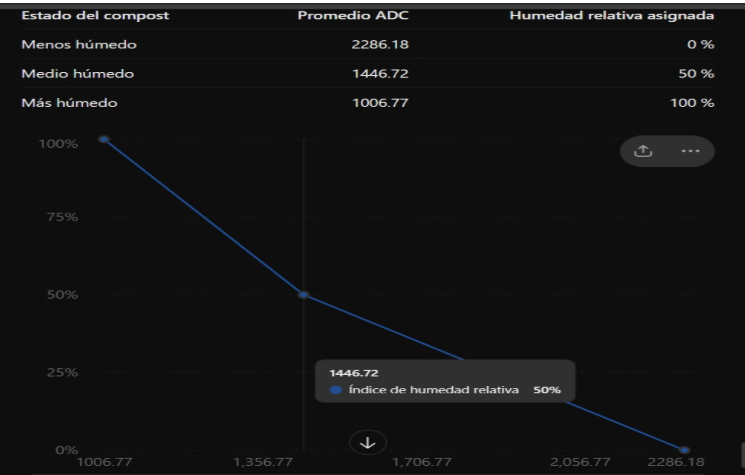)
> **Figura 3.** Curva de referencia para la calibración de humedad del compost.  
> *Nota. Registro propio de los resultados de Arduino IDE.*

Se observa que, a medida que aumenta la humedad del compost, disminuye el valor ADC. Esta relación permite diferenciar los niveles de humedad y facilita el monitoreo de las condiciones internas de COMPOSTECH, ayudando a determinar cuándo es necesario realizar la hidratación manual.

---

### B. Prueba de funcionamiento del sensor de temperatura (DS18B20)

**Procedimiento:** Se conectó el sensor de temperatura DS18B20 al controlador ESP32 para monitorear las condiciones térmicas del compost. Mediante Arduino IDE se verificó la recepción y visualización de las lecturas de temperatura.

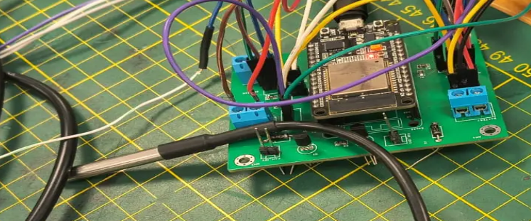
> **Figura 4.** Montaje y conexión del sensor de temperatura DS18B20.  
> *Nota. Registro fotográfico propio del equipo COMPOSTECH.*

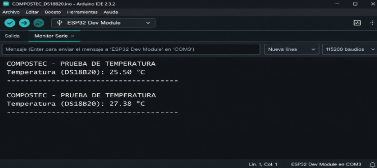
> **Figura 5.** Comprobación del registro de temperatura mediante Arduino IDE.  
> *Nota. Registro propio de los resultados de Arduino IDE.*

**Justificación de funcionamiento:**  
Durante las pruebas de hardware se registraron temperaturas de 25.50 °C mediante Arduino IDE y 27.375 °C mediante Firebase. Estas lecturas permiten verificar la recepción de los datos del sensor y su utilidad para el monitoreo térmico del compostador.

---

### C. Prueba de funcionamiento del sensor de gases (MQ-135)

**Procedimiento:** Se conectó el sensor de gases MQ-135 al controlador ESP32 para monitorear las variaciones de gases generados durante la descomposición de los residuos orgánicos. Mediante Arduino IDE se verificó el registro de sus lecturas.

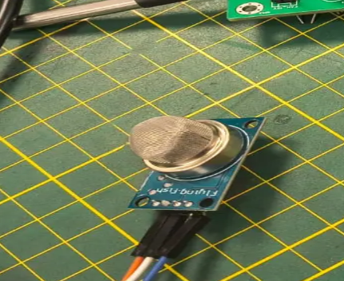
> **Figura 7.** Montaje y conexión del sensor de gases MQ-135 de COMPOSTECH.  
> *Nota. Registro fotográfico propio del equipo COMPOSTECH.*

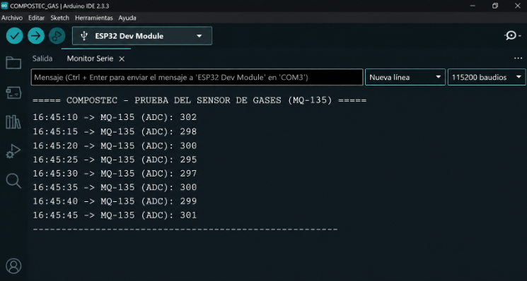
> **Figura 8.** Comprobación de las lecturas del sensor de gases MQ-135 mediante Arduino IDE.  
> *Nota. Registro propio de los resultados de Arduino IDE.*

**Justificación de funcionamiento:**  
Durante el compostaje, la descomposición de la materia orgánica genera diferentes gases. El sensor MQ-135 permite monitorear cambios en la calidad del aire dentro del compostador, proporcionando información complementaria para evaluar las condiciones de ventilación.

---

### D. Prueba de funcionamiento del detector de rebalse de lixiviados (P45)

**Procedimiento:** Se conectó el sensor de flotación P45 al controlador ESP32. Para evaluar su funcionamiento, se plantea incrementar progresivamente el nivel de agua en el recipiente recolector, simulando la acumulación de lixiviados, y verificar el cambio de estado del sensor mediante Arduino IDE.

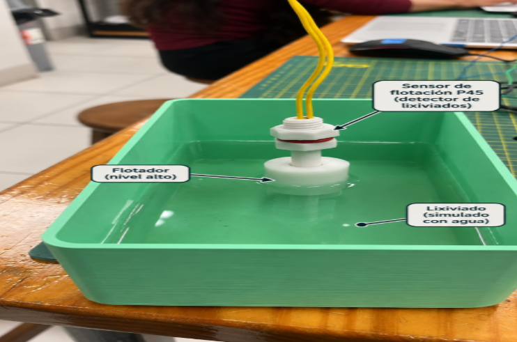
> **Figura 10.** Representación de la prueba del sensor P45 utilizando agua.  
> *Nota. Registro fotográfico propio del equipo COMPOSTECH.*

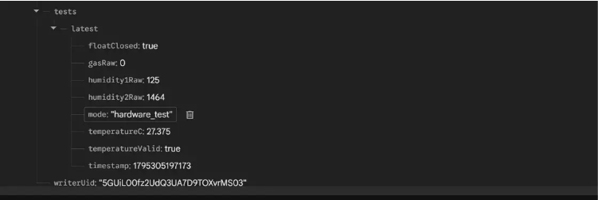
> **Figura 11.** Registro digital del estado del sensor P45 mediante Firebase.  
> *Nota. Registro propio de los resultados de Firebase.*

**Justificación de funcionamiento:**  
El sensor P45 permite detectar el aumento del nivel de líquido mediante el movimiento del flotador. El estado `true` indica que el contacto del sensor se encuentra cerrado, mientras que `false` indica que se encuentra abierto. Su incorporación en COMPOSTECH tiene como finalidad advertir sobre la acumulación excesiva de lixiviados y prevenir su desbordamiento. La correspondencia entre estos estados y el nivel crítico debe verificarse experimentalmente.

---

### E. Prueba de funcionamiento del sistema de ventilación

**Procedimiento:** Se conectaron los dos ventiladores al controlador ESP32 y se programaron ciclos de encendido y apagado cada cinco segundos mediante Arduino IDE, con la finalidad de verificar su funcionamiento.

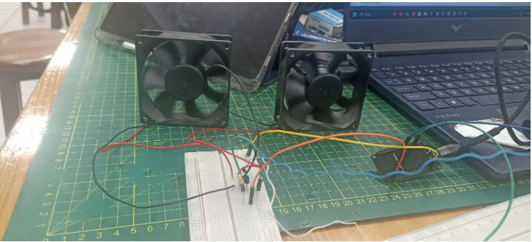
> **Figura 12.** Montaje y prueba de funcionamiento de los ventiladores de COMPOSTECH.  
> *Nota. Registro fotográfico propio del equipo COMPOSTECH.*

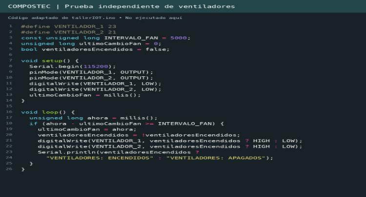
> **Figura 13.** Código de programación para la prueba de los ventiladores en ESP32.  
> *Nota. Registro propio de los resultados de Arduino IDE.*

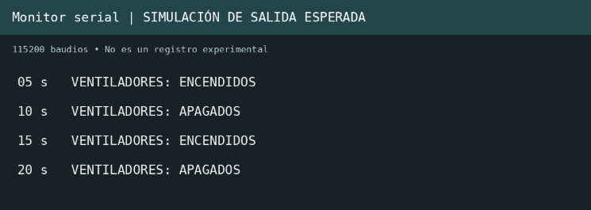
> **Figura 14.** Resultado esperado en el monitor serial de Arduino IDE.  
> *Nota. Registro propio de los resultados de Arduino IDE.*

**Justificación de funcionamiento:**  
Mediante la programación del ESP32 se establecieron intervalos de 5000 milisegundos (5 segundos) para el encendido y apagado automático de los dos ventiladores. El monitor serial de Arduino IDE permite visualizar el estado de funcionamiento de ambos componentes.

Esta programación permite controlar la ventilación de COMPOSTECH para favorecer la circulación de aire durante el proceso de compostaje.

* **Criterio de aceptación:** Encendido y apagado automático de ambos ventiladores según los intervalos programados.

---

### F. Prueba de funcionamiento de la pantalla OLED

La pantalla OLED permite visualizar directamente las condiciones internas del compostador, facilitando el seguimiento del proceso de compostaje sin necesidad de utilizar una computadora o acceder a Firebase.

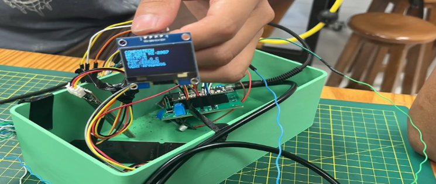
> **Figura 15.** Prueba de funcionamiento y visualización de datos mediante la pantalla OLED de COMPOSTECH.  
> *Nota. Registro fotográfico propio del funcionamiento de la pantalla OLED.*

La evidencia fotográfica muestra que la pantalla se encuentra encendida y presenta información del sistema electrónico, lo que permite comprobar su funcionamiento básico y su comunicación con el ESP32.

* **Criterio de aceptación:** Visualización y actualización correcta de las lecturas de los sensores y del estado de los ventiladores.

---

### G. Prueba de funcionamiento del sistema integrado y alimentación energética mediante powerbank

**Procedimiento:** Se plantea conectar el sistema electrónico de COMPOSTECH al powerbank mediante un cable USB para verificar el funcionamiento simultáneo de los sensores, los ventiladores y la pantalla OLED, así como el registro de las lecturas mediante Arduino IDE.

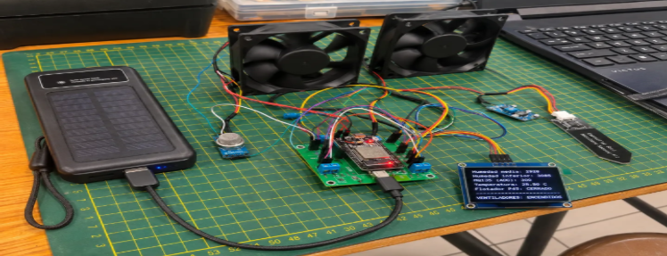
> **Figura 16.** Representación de la conexión del sistema electrónico al powerbank.  
> *Nota. Registro fotográfico propio del equipo COMPOSTECH.*

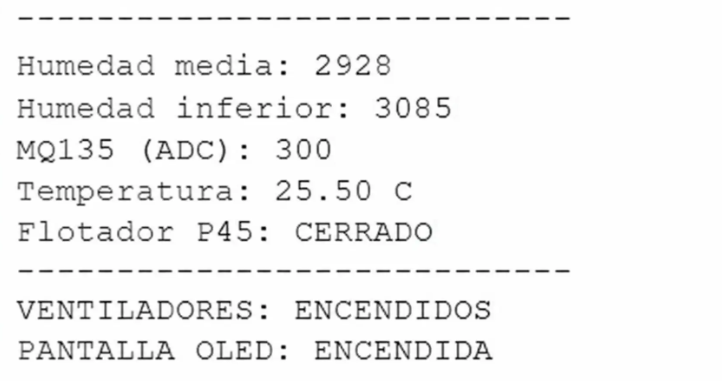
> **Figura 17.** Registro esperado del funcionamiento de los componentes mediante Arduino IDE.  
> *Nota. Registro propio de los resultados de Arduino IDE.*

**Justificación de funcionamiento:**  
La integración de los componentes electrónicos y su alimentación mediante el powerbank permiten evaluar la capacidad de COMPOSTECH para operar sin depender de una conexión permanente a la red eléctrica. La prueba busca verificar el funcionamiento simultáneo de los sensores, los ventiladores, la pantalla OLED y la comunicación de datos mediante el controlador ESP32.

* **Criterio de aceptación:** Funcionamiento simultáneo de los componentes electrónicos, registro correcto de las lecturas y suministro energético sin interrupciones durante la prueba.

---

# 7. RESULTADOS EXPERIMENTALES

### 7.1. Obtención y construcción de la base de datos

Durante el TRL 3 se identificaron y utilizaron conjuntos de datos (*datasets*) de investigaciones sobre compostaje, [2]. Sin embargo, ninguna fuente reunía todas las variables de los sensores de COMPOSTECH bajo las mismas condiciones de operación. Por ello, el equipo decidió construir una base de datos propia mediante la elaboración de compost desde cero con residuos vegetales. Debido al tiempo disponible, se obtuvieron datos iniciales y se adquirió compost previamente elaborado para obtener referencias de la etapa final.

Para complementar las etapas intermedias, se construyó un escenario aproximado mediante inteligencia artificial, tomando como referencia las bases externas revisadas [1] y los rangos bibliográficos de temperatura y humedad, [7]. Los datos simulados se mantienen separados de las mediciones propias y no constituyen resultados de un modelo predictivo validado.

**Tabla 7.1. Bases de datos externas revisadas y utilizadas**

| Archivo / fuente | Registros | Uso y alcance |
| :--- | :---: | :--- |
| `Exp1_2.xlsx` – Patiño-Forero [3] | 7 378 | Utilizado para explorar la predicción de temperatura y aireación. Residuos avícolas; condiciones distintas al prototipo. |
| `BIN 1 FInal.csv` – Kameswari et al. [4] | 43 | Utilizado para predicción diaria de temperatura y humedad; unidades de humedad por verificar. |
| `interpolated_data_bin_2.csv` | 42 | Revisado como referencia de residuos de frutas y verduras; contiene datos interpolados. |
### 7.2. Escenario estimado del ciclo de compostaje

Se adoptó un horizonte referencial de 90 días para representar las cuatro fases del compostaje, [7]. La duración de las fases y los valores son supuestos de simulación, no mediciones de COMPOSTECH. En un recipiente doméstico de 42 L, la fase termófila puede ser breve o no alcanzarse.

**Tabla 7.2. Fases consideradas en el escenario**

| Fase | Días | Temperatura orientativa | Humedad orientativa |
| :--- | :---: | :---: | :---: |
| Mesófila | 1–7 | 25–42 °C | 50–60 % |
| Termófila | 8–21 | 45–55 °C | 50–60 % |
| Enfriamiento | 22–45 | 30–44 °C | 45–55 % |
| Maduración | 46–90 | 24–30 °C | 35–45 % |

> *Nota. Rangos de trabajo propuestos para el escenario, adaptados de, [7].*

**Tabla 7.3. Datos obtenidos de la etapa mesófila, maduración y datos obtenidos por la IA de las etapas termófila y enfriamiento de días representativos**

| Día | Fase | H. media (%) | H. inferior (%) | T (°C) | MQ-135 (ADC) |
| :---: | :--- | :---: | :---: | :---: | :---: |
| 1 | Mesófila | 55 | 59 | 25.5 | 280 |
| 4 | Mesófila | 54 | 58 | 34.2 | 310 |
| 7 | Mesófila | 52 | 56 | 42 | 350 |
| 10 | Termófila | 51 | 55 | 48.5 | 390 |
| 14 | Termófila | 54 | 58 | 54.2 | 430 |
| 18 | Termófila | 52 | 56 | 51.3 | 405 |
| 21 | Termófila | 50 | 54 | 45.8 | 380 |
| 28 | Enfriamiento | 49 | 53 | 40.5 | 345 |
| 35 | Enfriamiento | 48 | 52 | 35.8 | 320 |
| 42 | Enfriamiento | 46 | 50 | 31.6 | 290 |
| 45 | Enfriamiento | 45 | 49 | 30.2 | 275 |
| 50 | Maduración | 44 | 45 | 29 | 260 |
| 60 | Maduración | 42 | 44 | 27.5 | 245 |
| 70 | Maduración | 40 | 43 | 26.2 | 230 |
| 80 | Maduración | 38 | 41 | 25.4 | 220 |
| 90 | Maduración | 35 | 39 | 24.8 | 210 |

> *Nota. Escenario ilustrativo a partir de los datos obtenidos en la investigación, en la elaboración del compost y también generado con IA.*

### 7.3. Representación gráfica del escenario

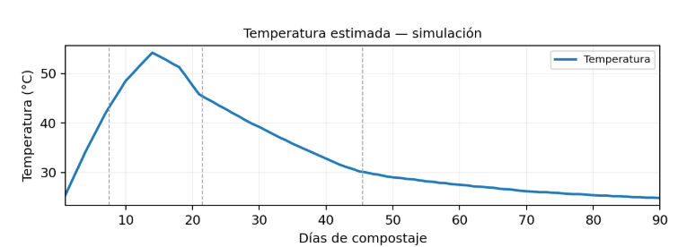
> **Figura 7.1.** Temperatura estimada durante el ciclo de compostaje. *Nota. Elaboración propia a partir de los datos y datos simulados en Excel.*

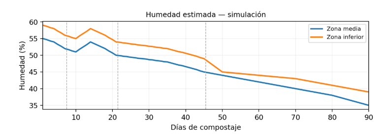
> **Figura 7.2.** Humedad estimada durante el ciclo de compostaje. *Nota. Elaboración propia a partir de los datos y datos simulados en Excel.*

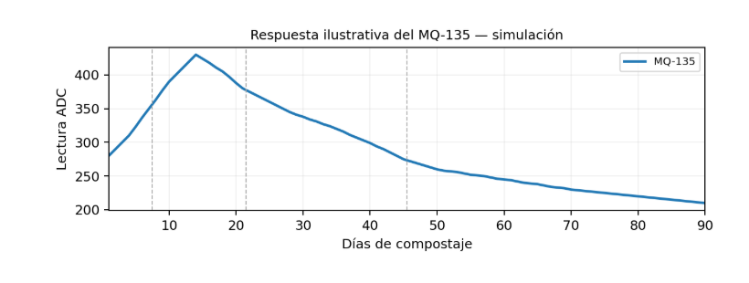
> **Figura 7.3.** Respuesta ilustrativa del MQ-135 durante el ciclo de compostaje. *Nota. Elaboración propia a partir de los datos y datos simulados en Excel.*

---

# 8. ANÁLISIS Y DISCUSIÓN DE RESULTADOS

### 8.1. Humedad y temperatura
De acuerdo con la Tabla 7.3, durante las fases mesófila y termófila, la humedad se mantiene entre 50 % y 59 %, condiciones favorables para la descomposición de los residuos orgánicos según la literatura de compostaje, [7]. Asimismo, la zona inferior presenta mayor humedad que la zona media, lo que podría relacionarse con la acumulación de agua por gravedad. Durante la maduración, la humedad disminuye hasta alcanzar valores de 35 % y 39 %, respectivamente.

Respecto a la temperatura, el escenario presentado muestra un incremento desde 25,5 °C hasta un máximo de 54,2 °C en el día 14, correspondiente a la fase termófila. Posteriormente, disminuye progresivamente hasta alcanzar 24,8 °C en el día 90. Este comportamiento es compatible con la evolución térmica esperada del compostaje, [7] y permite establecer condiciones de referencia para el monitoreo mediante COMPOSTECH.

### 8.2. Gases y lixiviados
Las lecturas referenciales del sensor MQ-135 muestran un incremento desde 280 ADC hasta un máximo de 430 ADC durante la fase termófila, coincidiendo con el periodo de mayor actividad microbiana del escenario, [6]. Posteriormente, disminuyen hasta 210 ADC durante la maduración. Esta tendencia representa un posible comportamiento de las emisiones durante la descomposición, aunque requiere validación experimental y calibración del sensor.

Por otro lado, el detector P45 complementa el monitoreo mediante el registro del estado del flotador, permitiendo identificar posibles situaciones de acumulación excesiva de lixiviados. Sin embargo, la Tabla 7.3 no incluye mediciones de esta variable.

### 8.3. Integración del sistema e inteligencia artificial
La combinación de bases de datos externas, registros propios y valores estimados mediante inteligencia artificial permitió construir un escenario representativo de las cuatro fases del compostaje durante un periodo de 90 días.

La integración de los sensores, los ventiladores, la pantalla OLED y las plataformas Arduino IDE y Firebase facilita el seguimiento de las condiciones internas del compostador. En concordancia con estudios previos de monitoreo inteligente de compostaje, [5], esta información constituye una base para el desarrollo de modelos de inteligencia artificial orientados al monitoreo de COMPOSTECH y a la identificación de condiciones que requieran hidratación manual o ventilación.

### 8.4. Evaluación del TRL 4
Las pruebas de funcionamiento y los registros disponibles evidencian avances en la integración de los componentes electrónicos de COMPOSTECH. Asimismo, la base de datos construida permite evaluar de manera preliminar el comportamiento esperado de las variables durante las diferentes fases del compostaje.

Estos resultados contribuyen a la validación tecnológica del TRL 4 en condiciones controladas, aunque se requiere complementar las estimaciones con mediciones experimentales de un ciclo completo de compostaje.

---

# 9. LIMITACIONES Y OPORTUNIDADES DE MEJORA

A partir de las pruebas realizadas, se identificaron las siguientes limitaciones y acciones de mejora para fortalecer el funcionamiento de COMPOSTECH y avanzar en su validación tecnológica.

| Limitación identificada | Oportunidad de mejora |
| :--- | :--- |
| Registros incompletos del ciclo de compostaje. | Monitorear un mismo lote desde su preparación hasta la maduración, registrando fechas, riego y ventilación. |
| Calibración preliminar de humedad y temperatura. | Calibrar ambos sensores de humedad mediante mediciones gravimétricas y comparar la temperatura con un termómetro de referencia. |
| Respuesta del MQ-135 y detector P45 parcialmente verificada. | Comprobar la respuesta del MQ-135 en condiciones controladas y verificar ambos estados del flotador con distintos niveles de agua. |
| Autonomía del powerbank y ventilación sin evaluación prolongada. | Medir el tiempo de funcionamiento con todos los componentes activos y comprobar los ciclos de ventilación. |
| Modelos de IA con datos externos y simulados. | Recopilar ciclos propios y evaluar los modelos con datos independientes antes de implementar alertas automáticas. |

> *Nota. Elaboración propia a partir de las pruebas y resultados de COMPOSTECH.*

---

# 10. CONCLUSIONES

1. Las pruebas de laboratorio permitieron verificar la recepción de las lecturas de los sensores, el encendido de los ventiladores y la visualización de información mediante la pantalla OLED, evidenciando la integración básica de los componentes electrónicos de COMPOSTECH.
2. La utilización de bases de datos externas, registros propios y datos estimados mediante inteligencia artificial permitió representar las diferentes fases del compostaje y orientar el desarrollo del sistema de monitoreo.
3. COMPOSTECH presenta avances en la validación tecnológica correspondiente al TRL 4 mediante pruebas de baja fidelidad en condiciones controladas. Sin embargo, se requiere completar la calibración de los sensores y evaluar la estabilidad del sistema integrado para confirmar su cumplimiento integral.

---

# 11. REFERENCIAS DE APOYO

* **[1]** Equipo COMPOSTECH, “Informe de avance de inteligencia artificial, TRL 3”, documento interno, 9 nov. 2026.
* **[2]** Equipo 06, “Guía de bases de datos para la IA de COMPOSTEC”, documento interno, 8 nov. 2026.
* **[3]** A. Patiño-Forero, “Dataset supporting: Dynamic modeling of poultry litter composting in high mountain climates using system identification techniques”, versión 2, Mendeley Data, 2024, doi: `10.17632/dgxxj2pk8s.2`.
* **[4]** S. G. V. Kameswari, A. Basavaraju, C. S. Kumar y J. Bapat, “Compost monitoring system for kitchen waste management: Development, deployment and analysis”, *IoT*, vol. 6, n.º 4, art. 64, 2025, doi: `10.3390/iot6040064`.
* **[5]** A. Khandakar et al., “Compost maturity prediction and gas emissions monitoring: A sensor-based and interpretable machine learning approach”, *Comput. Electr. Eng.*, vol. 123, art. 110115, 2025, doi: `10.1016/j.compeleceng.2025.110115`.
* **[6]** R. V. Misra, R. N. Roy y H. Hiraoka, *On-farm composting methods*. Roma, Italia: FAO, 2003. [En línea]. Disponible: <https://fao.org>
* **[7]** Cornell University, “Cornell composting”. [En línea]. Disponible: <https://cornell.edu>

